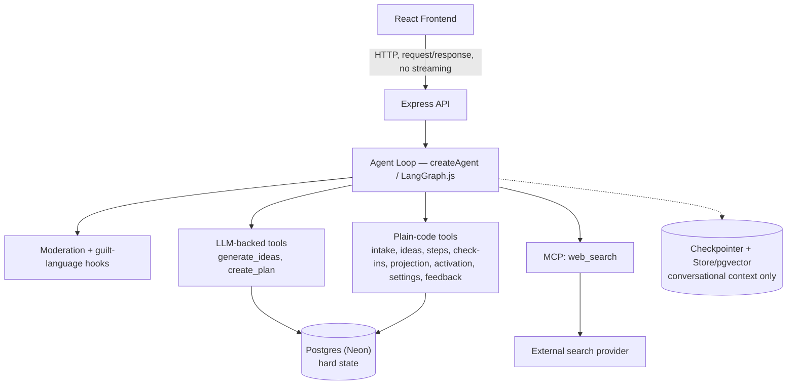

# Second Income Coach

> An AI agent that turns "I want extra income" into a tailored plan and sticks with you through it — without guilt-tripping you when life gets in the way.

## The problem

People who want a second income stream face two barriers:

1. **Idea paralysis** — generic "extra income idea" lists aren't matched to actual skills, time, or risk appetite.
2. **Inconsistent follow-through** — momentum breaks after a life disruption, with no low-friction, judgment-free way back in.

Idea-generation quizzes already solve half of this. None pair tailored ideas with a non-punitive accountability loop. Second Income Coach does both.

## What it does

| # | Capability |
|---|---|
| CAP-1 | Structured intake (skills, interests, time, risk tolerance, budget) that also classifies *why* past attempts stalled, into one of five failure patterns |
| CAP-2 | 5 tailored income ideas per intake, each with a rationale tied to at least 3 intake fields; bookmark, reject, or request more |
| CAP-3 | A draft plan of small, sequenced steps — sized to the user's failure pattern — revealing only the current + next step |
| CAP-4 | Ongoing check-ins by text or voice (recorded → transcribed → user-confirmed); missed check-ins auto-reshuffle the timeline, no shame |
| CAP-5 | A live income/opportunity projection that updates with real progress |
| CAP-6 | Human-confirmed plan activation (HITL) — only one plan active at a time, others pause rather than vanish |
| CAP-7 | Settings: agent personality, model choice (transparent pricing registry), UI language, currency |
| CAP-8 | Token count + estimated cost shown under every response |
| CAP-9 | Thumbs up/down feedback, never gating the chat |
| CAP-10 | Bilingual (German/English) chat, matched per message to whatever language the user used |
| CAP-11 | A public, unauthenticated "Quality & Decisions" page: eval results, key architecture decisions, and a reflection — all generated from source, never hand-copied |

Full detail: [`_bmad-output/specs/spec-second-income-coach/SPEC.md`](_bmad-output/specs/spec-second-income-coach/SPEC.md).

## Non-goals (v1)

- No gamified visual layer (avatar, pet, plant, points, streaks)
- No streak counters or escalating guilt-based nudges, anywhere
- No live FX API — currency conversion uses one configured rate, labeled an estimate
- Voice v2 (speech-to-speech) is deferred; v1 is record → transcribe → user-confirmed-transcript

## Tech stack

| Layer | Choice |
|---|---|
| Language | TypeScript 7.0.2 |
| Runtime | Node.js 26 (Active LTS) |
| Frontend | React 19.3.1 (React Compiler), TanStack Query |
| Backend | Express |
| Agent framework | LangChain `createAgent` on the LangGraph.js runtime |
| Persistence | Postgres (Neon) — hard state, checkpointing, and semantic memory (pgvector) |
| Auth | Google OAuth (`google-auth-library`) |
| Moderation | Mistral Moderation 2 |
| Voice (v1) | `gpt-transcribe` |
| i18n | `react-i18next` |
| Schemas | Zod (shared backend/frontend, types via `z.infer`) |
| DB access | Drizzle ORM (parameterized by construction) |
| API security | `helmet`, `cors` (origin allowlist), `express-rate-limit` |
| Evals | `agentevals` + Vitest, traced in LangSmith |
| Hosting | Cloud Run (app) + Neon (Postgres), local-only until after the live demo |

## Architecture at a glance

One LLM agent with tool-calling (not multi-agent). Tools split into three kinds:

- **LLM-backed** (generation only): `generate_ideas`, `create_plan`
- **Plain-code** (deterministic, direct Postgres read/write): `submit_intake`, `set_idea_status`, `get_current_step`, `start_step`, `complete_step`, `record_check_in`, `get_projection`, `activate_plan`, `set_personality`, `set_model`, `set_ui_language`, `set_currency`, `record_feedback`
- **MCP**: `web_search` (grounds idea generation only)



Full detail (30 architecture decisions, rationale, and trade-offs): [`ARCHITECTURE-SPINE.md`](_bmad-output/planning-artifacts/architecture/architecture-p_3-2026-11-13/ARCHITECTURE-SPINE.md).

## Technical decisions

The actual agent-engineering choices — not settings or business rules. The six you'd see first were examples of the *kind* of thing that belongs here, not the whole list — this is the full set:

- **Single agent, not multi-agent** — one LLM with tool-calling (`createAgent` on the LangGraph.js runtime); no orchestrator or second agent layered on top, to avoid tool-overload confusion.

- **Tool boundary: LLM-backed vs. plain-code vs. MCP** — idea/plan generation (nondeterministic) and everything else (deterministic Postgres reads/writes) are different tool types; no nondeterministic tool is ever allowed to mutate state. `web_search` is the only MCP tool, used only to ground idea generation.

- **State ownership split** — facts that must be exact (current step, plan status, timeline) live only in Postgres and are always re-read fresh, never cached or trusted from the checkpointer. Semantic memory retrieval (Postgres `Store` + pgvector) is used for conversational context and for recalling rated traces — and it's deliberately kept separate from those hard facts for exactly one reason: a step/plan/status value must never be reconstructed from a fuzzy vector-similarity retrieval instead of a precise DB read. Service handles (DB pool, LangSmith client) are injected via runtime context, never stored as graph state — three clearly separated homes, never mixed.

- **Checkpointers & threads for conversation memory** — each user gets one "discovery" thread (intake + browsing ideas) plus a separate thread per activated plan. Conversation state persists via LangGraph's Postgres-backed checkpointer, so it survives reloads and restarts, not just in-memory.

- **Human-in-the-loop plan activation, enforced at the database** — a generated plan never goes live on its own. Execution pauses (LangGraph's `interrupt()`) and waits for explicit user confirm/edit/reject. "Only one active plan" isn't just an app-level check — it's a database-level constraint inside a single transaction.

- **Explicit idea/plan status machine** — ideas and plans move through a fixed set of states (e.g. `suggested → selected/bookmarked/rejected`; `draft → active/paused → completed`), not ad hoc boolean flags.

- **Middleware for moderation, safety & error handling** — every model/tool call passes through composable hooks (`beforeModel` / `afterModel` / `wrapToolCall`). This is where content moderation, the "no guilt/streak language" check, and error/fallback handling live — deliberately kept separate from retries (below) so the two mechanisms don't duplicate or conflict.

- **LangGraph for retries, timeouts & caching** — instead of hand-rolled retry logic, every tool/model call gets a retry policy, timeout, and cache policy configured once per node type: the idea/plan-generation calls get long timeouts and no caching (output is personalized per user), while the web-search tool gets a short-lived cache (results repeat across users).

- **Voice behind one swappable interface** — a single contract (`transcribeCheckIn`/`speakResponse`) sits between check-in logic and the voice vendor, so swapping the underlying model never touches business logic. v1 captures audio client-side with the browser's `MediaRecorder` API, sends it to the backend, and uses `gpt-transcribe` for transcription only (record → transcribe → user confirms/edits the text before it's submitted); v2 (deferred) would swap in `gpt-audio-mini` for full speech-to-speech through the same interface. Transcription itself always happens server-side — the API key never reaches the browser.

- **One shared schema as the single source of truth** — Zod schemas define types once, shared by backend and frontend (`z.infer`, never hand-written twice), and kept in lockstep with the database's own enum definitions.

- **Session & CSRF handling** — the authenticated session is a server-side cookie (`HttpOnly`, `Secure`, `SameSite=Lax`), never a bearer token exposed to JS; state-changing requests are additionally checked against the `Origin` header — that pair is the CSRF defense, no separate CSRF-token scheme needed.

- **Security baseline: injection, XSS, rate limiting** — all Postgres access goes through an ORM (Drizzle) that parameterizes queries by construction, never hand-built SQL; agent/user content is never rendered via `dangerouslySetInnerHTML` (lint-enforced); every route is rate-limited (tighter on the expensive idea/plan-generation calls), with a request body-size cap and a max message length enforced at the schema boundary.

- **Feedback loop for improvement, not training** — a thumbs up/down rating feeds exactly two places: per-user semantic memory (so it can be recalled as context in later turns) and a LangSmith dataset of rated traces, used only for offline prompt improvement — never for model training. A positive rating never excuses a hard-constraint violation (e.g. rating a guilt-language response positively doesn't exempt it from that check), and comment text passes through the same moderation as any other input.

- **LangSmith for agent observability** — every turn is traced, so what the agent actually did — which tools it called, with what arguments, what came back — is inspectable, not just the final reply.

- **Evaluation stack: `agentevals` + Vitest** — the TypeScript equivalent of Ragas (Python's standard LLM/agent-eval framework). Two distinct kinds of checks: deterministic tests that the agent called the right tool with the right arguments (no model judgment, pure pass/fail), plus a smaller set of judge-model-graded quality checks. Both run against all 4 selectable models, so results are comparable model-to-model rather than validated against only whichever one you happened to test with.

Full rationale, trade-offs, and everything settings/business-facing (personality, model picker, currency, UI language, cost display, feedback): [`ARCHITECTURE-SPINE.md`](_bmad-output/planning-artifacts/architecture/architecture-p_3-2026-11-13/ARCHITECTURE-SPINE.md).

## Tools the agent calls

Every tool the agent can invoke, split by the same boundary the architecture enforces: **LLM-backed** (nondeterministic, generates content) vs. **plain-code** (deterministic, direct Postgres read/write) vs. **MCP** (external, via the Model Context Protocol). No LLM-backed tool is ever allowed to mutate state — only plain-code tools write to Postgres.

| Tool | Type | Does |
|---|---|---|
| `generate_ideas` | LLM-backed | Produces the 5 tailored income ideas from a completed intake; the only tool that calls `web_search` |
| `create_plan` | LLM-backed | Produces the draft step-by-step plan for a selected idea |
| `submit_intake` | Plain-code | Persists intake answers + the classified failure pattern |
| `set_idea_status` | Plain-code | Marks an idea bookmarked/rejected/selected |
| `get_current_step` | Plain-code | The sole read path for "current + next step only" visibility; also where missed-check-ins are lazily detected |
| `start_step` / `complete_step` | Plain-code | Distinct start/finish acknowledgments; reject if called on a step that isn't the plan's current one |
| `record_check_in` | Plain-code | Captures a check-in (text or voice-transcribed) and the energy/status input ahead of any task ask |
| `get_projection` | Plain-code | Reads the stored baseline rate + actual progress to compute the income/opportunity projection — never calls `web_search` itself |
| `activate_plan` | Plain-code | The human-in-the-loop gate — pauses for explicit confirm/edit/reject before a plan can become active |
| `set_personality` / `set_model` / `set_ui_language` / `set_currency` | Plain-code | Settings writes — always user-initiated via the UI, never a decision the agent makes on its own |
| `record_feedback` | Plain-code | Writes a rating + optional comment; never blocks the chat |
| `web_search` | MCP | The one external tool, wired via `@langchain/mcp-adapters`; grounds `generate_ideas` in real market data (including the baseline income rate, persisted once and never re-fetched) |

`web_search` is the only MCP integration in the system — there's no ready-made MCP server for the actual domain logic (idea matching, plan generation, check-in/accountability, income math), so all of that stays custom code. Search results pass through moderation (`wrapToolCall`) before they're cached or re-enter model context, so a cache hit can never bypass that check.

## Project status

Planning is complete and reviewed (spec → architecture → 3-reviewer gate → epics). Implementation hasn't started yet — see [`_bmad-output/implementation-artifacts/sprint-status.yaml`](_bmad-output/implementation-artifacts/sprint-status.yaml) for the 7-epic/28-story breakdown and current status of each.

```
Epic 1: Sign In & First Contact
Epic 2: Tailored Idea Discovery
Epic 3: Plan Creation & Activation
Epic 4: Check-Ins, Accountability & Payoff
Epic 5: Settings, Cost Transparency & Feedback
Epic 6: Automated Evaluation & Quality Report
Epic 7: Documentation & Deployment Handoff
```

## Documentation map

| Document | Contents |
|---|---|
| [`SPEC.md`](_bmad-output/specs/spec-second-income-coach/SPEC.md) | Canonical contract: capabilities, constraints, non-goals, success signal |
| [`stack.md`](_bmad-output/specs/spec-second-income-coach/stack.md) | Full stack/version detail |
| [`engagement-mechanics.md`](_bmad-output/specs/spec-second-income-coach/engagement-mechanics.md) | Income-projection formula and check-in mechanics detail |
| [`evals.md`](_bmad-output/specs/spec-second-income-coach/evals.md) | Eval tooling, test composition, report requirements |
| [`ARCHITECTURE-SPINE.md`](_bmad-output/planning-artifacts/architecture/architecture-p_3-2026-11-13/ARCHITECTURE-SPINE.md) | All 30 architecture decisions, rationale, and trade-offs |
| [`epics.md`](_bmad-output/planning-artifacts/epics.md) | Full epic/story breakdown with acceptance criteria |
| [`sprint-status.yaml`](_bmad-output/implementation-artifacts/sprint-status.yaml) | Live implementation tracking |

## Getting started

**Prerequisites:** Node.js 20.19+ (the architecture spine targets Node 26 once generally available), Docker (for local Postgres), npm 10+.

1. Copy the environment template and adjust if needed — every required variable is validated at backend startup (`src/config/env.ts`); a missing one fails fast with a clear message naming it, instead of a silent crash or hang:
   ```bash
   cp .env.example .env
   ```
2. Start local Postgres (Docker Compose):
   ```bash
   docker compose up -d
   ```
3. Install dependencies (npm workspaces: `shared`, `src`, `web` — one install, both sides import shared Zod schemas via `@app/shared`):
   ```bash
   npm install
   ```
4. Run both the Express backend and the React frontend:
   ```bash
   npm run dev
   ```
   - API: http://localhost:3000 — health checks at `GET /api/health` and `GET /api/health/db`
   - Frontend: http://localhost:5173 — Vite dev server, proxies `/api` to the backend (same-origin in production)

Other commands:

| Command | Does |
|---|---|
| `npm run build` | Production build of `shared`, `src`, and `web` |
| `npm run lint` | ESLint across the whole repo (`react/no-danger` enforced) |
| `npm run typecheck` | `tsc --noEmit` for every workspace |
| `npm test` | Vitest for every workspace |
| `npm run db:up` / `npm run db:down` | Start/stop the local Postgres container |

The frontend defaults to light mode; the dark-mode toggle (top-right) persists the choice in `localStorage` across reloads. Teal accent tokens and contrast ratios are pinned in `stack.md` and wired in `web/src/index.css`.

---

*This README is an interim snapshot generated from the planning artifacts above. Epic 7 (Story 7.1) finalizes it with setup instructions, worked example use cases, and the full technical-decision rationale once the app is built.*
