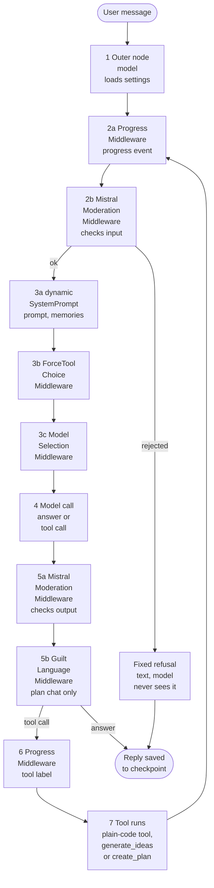
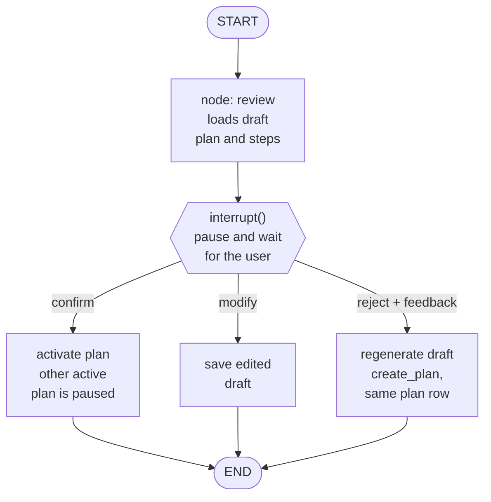
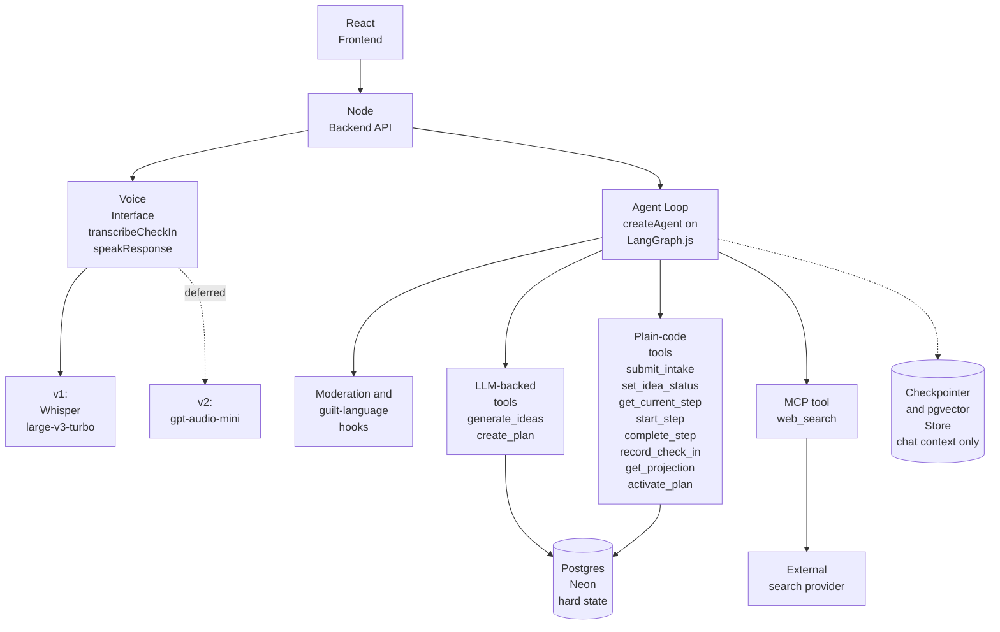
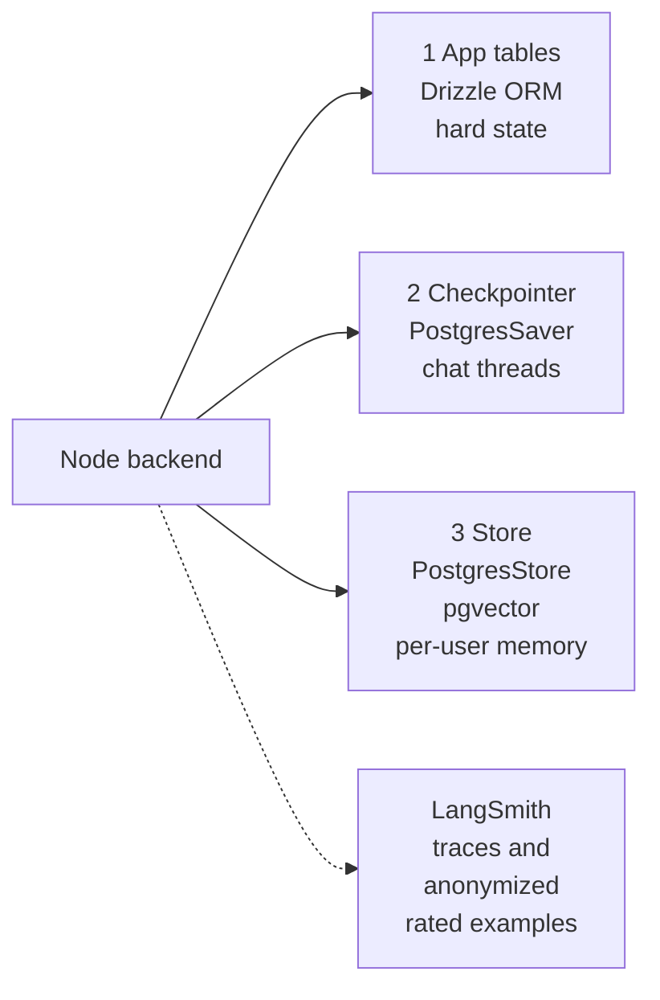
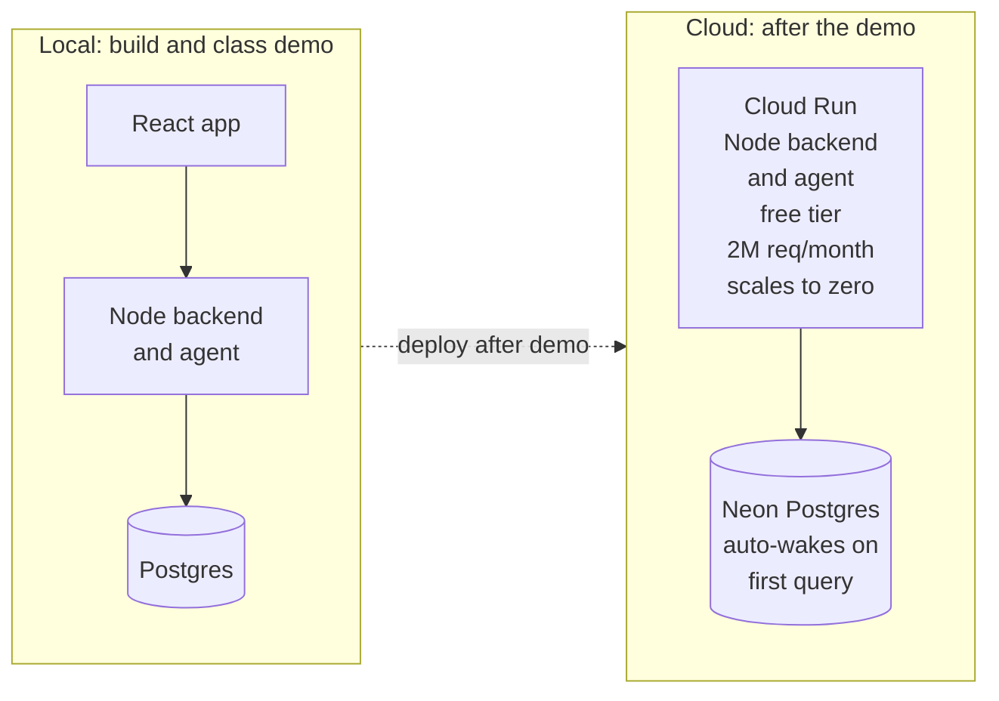

# Architecture Spine — Second Income Coach

## Design Paradigm

One LLM agent with tool-calling on LangChain's `createAgent` (LangGraph.js runtime). The agent loop, the three tool kinds (LLM-backed, plain-code, MCP), the persistence split and the reasons behind them are explained once, in [docs/TECHNICAL-RATIONALE.md](../../../../docs/TECHNICAL-RATIONALE.md). Below: how one chat turn runs through the middleware, and the one LangGraph graph we build ourselves (plan activation). Further down: dependency direction, models in use, stack and source tree.

### One chat turn (middleware lifecycle)

Source: `src/agent/index.ts` (`createCoachAgent`), `moderation.ts`, `guilt-language.ts`, `progress.ts`, `moderation-web-search.ts`. The turn is an outer `StateGraph` (START -> `model` -> END, with retry/timeout defaults and the Postgres checkpointer). The `model` node loads the user's settings, then runs the inner `createAgent` loop, whose middleware wraps every model and tool call.

1. **Outer node (`model`):** loads personality and model from `user_settings`, adds the plan-completed and already-checked-in notes.
2. **beforeModel:** (a) `ProgressMiddleware` emits the progress event; (b) `MistralModerationMiddleware` checks the user message (jailbreak or PII is rejected with a fixed text and ends the turn).
3. **wrapModelCall:** (a) `dynamicSystemPromptMiddleware` builds the system prompt with recalled memories; (b) `ForceToolChoiceMiddleware` forces the tool choice when the flow requires it; (c) `ModelSelectionMiddleware` picks the user's chosen model.
4. **Model:** answers or requests a tool call.
5. **afterModel:** (a) `MistralModerationMiddleware` checks the output; (b) `GuiltLanguageMiddleware` checks for guilt/streak language (plan chat only).
6. **wrapToolCall:** `ProgressMiddleware` emits the tool's progress label.
7. **Tool:** plain-code tools (`submit_intake`, `start_step`, `complete_step`, ...) or `generate_ideas` / `create_plan`. `generate_ideas` runs a fixed pipeline (query plan, parallel searches with budget guard and moderation, one writing call per idea, checks); see docs/TECHNICAL-RATIONALE.md. After a tool the loop returns to step 2.

### Plan activation graph (human in the loop)

The one graph we build ourselves (`src/tools/plain/activate_plan.ts`). The main chat agent comes from `createAgent`, which builds its own nodes internally. A plan only becomes `active` after the user's explicit decision: the graph pauses at `interrupt()` and the pause survives requests and restarts via the Postgres checkpointer.

> The full AD-1..AD-30 decision texts were removed from this file on 2026-11-19 (too long to read). AD-n ids stay cited by tests, epics.md and the docs; the full texts are in git history (see the commit that removes this block).

## Dependency direction

No arrow runs in reverse: tools never call the frontend, Postgres never calls back into the agent loop, and the voice implementation never calls check-in logic directly (only through the interface in AD-8).

## Where data is stored

One Postgres database holds everything we store about a user, in three separate homes (never mixed). Nothing else keeps user data: model and search providers only process requests.

| Home | Tables | What is saved |
|---|---|---|
| 1 App tables (hard state, always read fresh) | `users`, `session`, `user_settings`, `intake`, `ideas`, `idea_translations`, `plans`, `plan_steps`, `check_ins`, `message_costs`, `message_feedback`, `user_generation_counts`, `search_budget_counts` | Account and login session; settings (personality, model, language, currency); intake answers and failure pattern; ideas with rationale and sourced income rate; plans and steps with status and timeline; check-ins; token cost per message; thumbs ratings and comments; daily usage counters |
| 2 Checkpointer | `checkpoints`, `checkpoint_blobs`, `checkpoint_writes` | Conversation state of each thread: one discovery thread per user plus one thread per plan |
| 3 Store + pgvector | `store`, `store_vectors` | Per-user semantic memory, namespace `["memory", userId]`: the comments a user writes with a thumbs rating, embedded with `mistral-embed` (1024 dims) and recalled for similar questions |
| LangSmith (external) | none | Traces of agent turns; rated examples with PII anonymized, for offline prompt improvement only |

Voice recordings are never stored: the audio goes straight to transcription and is discarded.

## Models in use

Everything except Mistral runs through one OpenRouter key (`OPENROUTER_API_KEY`); Mistral uses `MISTRAL_API_KEY`.

| Purpose | Model | Provider | User-selectable |
|---|---|---|---|
| Coach agent (discovery chat, plan chat, check-in text) | `openai/gpt-6-luna` (default) | OpenRouter | Intended: Settings can switch to `google/gemini-3.8-flash` or `anthropic/claude-haiku-4.5` |
| `generate_ideas` (writing calls) and `create_plan` | `openai/gpt-6-luna` (default, same as the coach agent) | OpenRouter | follows the coach model |
| Guilt-language check (plan chat) | `openai/gpt-6-luna` (default, same as the coach agent) | OpenRouter | follows the coach model |
| Idea-card translation (DE/EN) | `openai/gpt-6-luna` | OpenRouter | no, fixed |
| Moderation (input, output, web-search results) | `mistral-moderation-2603` | Mistral | no |
| Memory embeddings (pgvector, 1024 dims) | `mistral-embed` | Mistral | no |
| Voice check-in transcription | `openai/whisper-large-v3-turbo` (the "gpt-transcribe" of AD-9) | OpenRouter | no |
| Web search (not an LLM) | Tavily via MCP `web_search` | Tavily | no |
| Evals only: judges | `google/gemini-3.8-flash`, `deepseek/deepseek-v4.1-flash` | OpenRouter | no |
| Evals only: fourth coach model under test (same cases as the three selectable ones) | `anthropic/claude-sonnet-5.5` | OpenRouter | no, not offered in the app |

## Consistency Conventions

| Concern | Convention |
| --- | --- |
| Data & formats (tool/API boundary types) | Zod schemas in one shared location, imported by backend and frontend; TypeScript types derived via `z.infer`, never hand-written separately (AD-16). |
| State & cross-cutting (mutation, errors, logging, auth) | Deterministic state mutation (step, check-in, activation) only via plain-code tools (AD-4); LLM-backed tools never mutate this state. Error handling and message/context trimming via composable middleware hooks (`beforeAgent`/`beforeModel`/`wrapModelCall`/`afterModel`/`afterAgent`). Moderation (AD-11) and the guilt-language check (AD-12) are mandatory hooks, not optional. Auth via Google OAuth (AD-17). `record_check_in` captures the energy/status input for CAP-4; the orchestrating agent must call it before offering any step-related ask within that check-in turn. |

## Stack

| Name | Version |
| --- | --- |
| TypeScript | 6.0.3 (deliberately not 7.x: typescript-eslint hard-errors on TS 7 as of 2026-11-15; revisit once that is fixed) |
| Node.js | 26 (Active LTS) |
| React | 19.3.1 |
| google-auth-library | 11.3.3 |
| Express | current |
| agentevals | current |
| Vitest | current |
| react-i18next | current |
| langchain (TypeScript) | 1.6.5 |
| @langchain/core | 1.3.6 |
| @langchain/langgraph | 1.7.3 |
| @langchain/langgraph-checkpoint-postgres | current (unpinned) |
| @langchain/mcp-adapters | 2.0+ |
| Whisper large-v3-turbo via OpenRouter (voice v1) | `openai/whisper-large-v3-turbo` |
| gpt-audio-mini (voice v2, deferred) | gpt-audio-mini-2025-12-15 |
| Mistral Moderation 2 | mistral-moderation-2603 |
| React Compiler (via @vitejs/plugin-react `reactCompilerPreset`; peers @rolldown/plugin-babel, babel-plugin-react-compiler, @babel/core) | current (Vite 8 + @vitejs/plugin-react v6) |
| TanStack Query | current |
| Zod | current |
| LangSmith | current |
| Neon (Postgres hosting) | — |
| Cloud Run (app hosting) | — |
| Drizzle ORM (Postgres access, AD-30) | current |
| helmet (Express security headers, AD-30) | current |
| cors (Express CORS allowlist, AD-30) | current |
| express-rate-limit (AD-30) | current |

## Structural Seed

### Deployment & environments

Local-only first, on the user's laptop, for build and the live class demo. Deploys afterward to Cloud Run (app hosting) + Neon (Postgres). Neon was chosen over Supabase and a self-hosted GCP VM specifically because it auto-wakes on query after scaling to zero, whereas Supabase's free tier pauses idle projects and requires a manual dashboard resume — unacceptable risk for a live demo. Google Cloud SQL has no perpetual free tier (only a 30-day trial) and was ruled out.

**Secrets/config:** local environment variables (`.env`) during local-only build and demo; Google Cloud's Secret Manager once deployed to Cloud Run. Applies to every credential this system holds: the voice model API key, Mistral Moderation's API key, the web-search MCP provider's key, the Google OAuth client secret (and the session secret), and the LangSmith API key.

**Env-variable rule:** every story that introduces an external service adds its variable(s) to `.env.example` (placeholders only - never a real key) and to the startup check in `src/config/env.ts`, which names a missing variable without printing any value and states per variable whether it is required at startup or optional (the feature degrades per its own story). The story's completion report states which keys the user must fill in. Introducing stories: 1.2 (Google OAuth, session secret), 1.3 (model, moderation, LangSmith), 2.2 (web search), 4.3 (voice), 7.3 (deploy secrets), plus 5.1/5.3 if they add a provider not already covered. The same startup check runs unchanged against Secret Manager-provided values after deploy.
