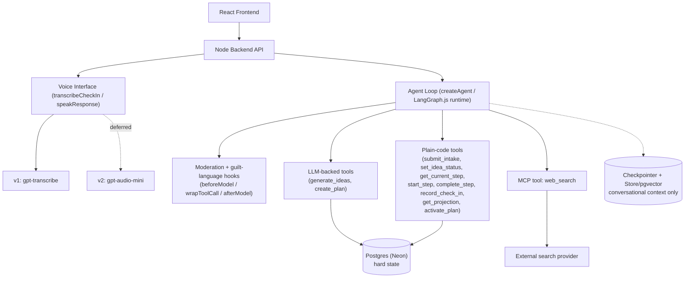
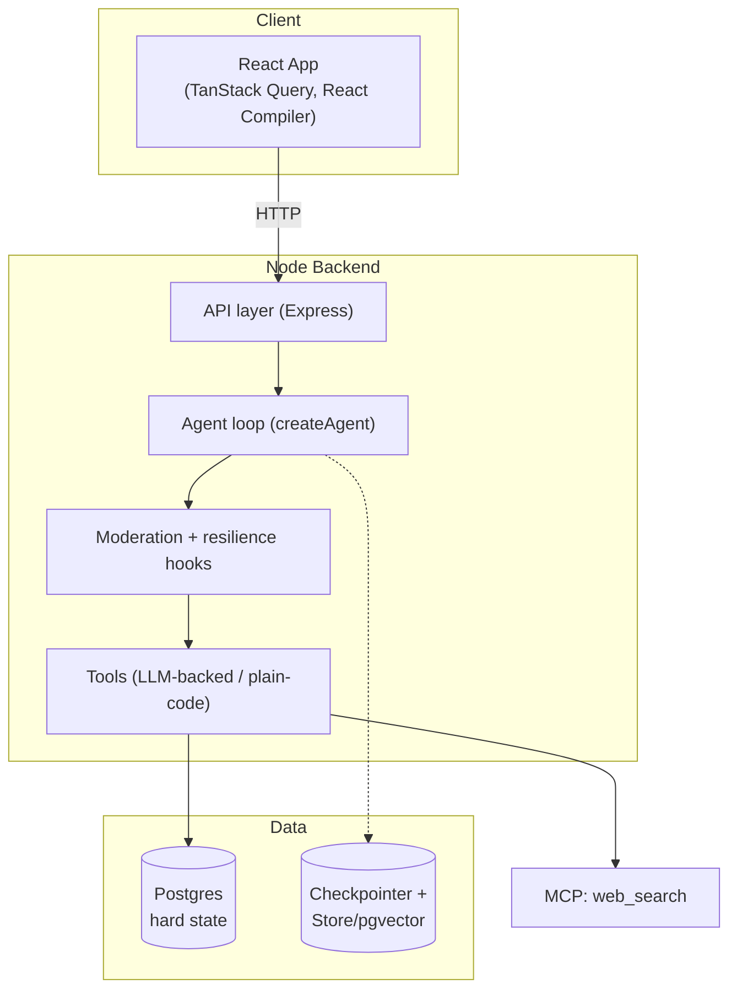
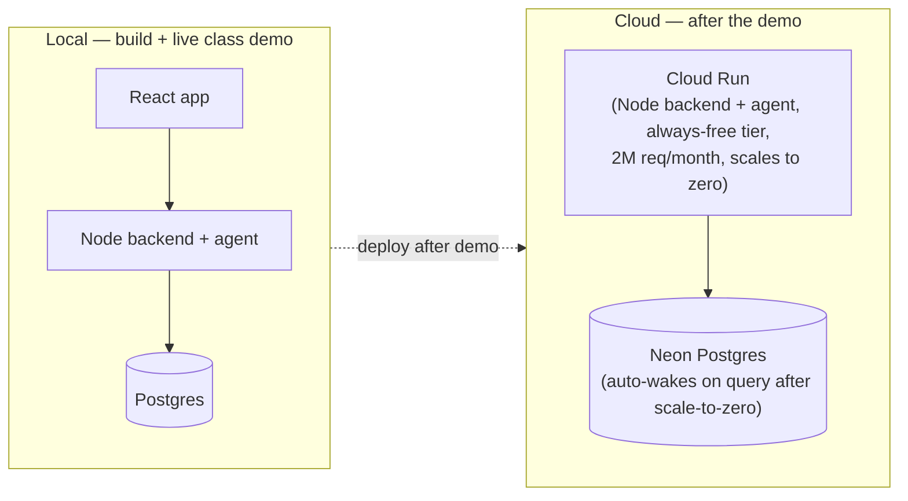

# Architecture Spine — Second Income Coach

## Design Paradigm

Single LLM agent with tool-calling (an agentic loop), not a multi-agent/orchestrator setup — the model calls domain-specific tools, observes results, and iterates before producing a final response. Implemented via LangChain's `createAgent` (TypeScript) running on the LangGraph.js runtime.

Namespace mapping:

- **Agent loop / middleware** — `createAgent` wiring, composable hooks (`beforeAgent` / `beforeModel` / `wrapModelCall` / `afterModel` / `afterAgent`), node-level resilience config (`setNodeDefaults`).
- **LLM-backed tools** — generation-only tools whose output is non-deterministic: `generate_ideas`, `create_plan`.
- **Plain-code tools** — deterministic tools that read/write Postgres directly: `submit_intake`, `set_idea_status`, `get_current_step`, `start_step`, `complete_step`, `record_check_in`, `get_projection`, `activate_plan`.
- **MCP tool** — `web_search`, wired via `@langchain/mcp-adapters`, used only by `generate_ideas` (CAP-2), which is where the baseline income rate is sourced at idea-generation time per AD-6; `get_projection` never calls it.
- **Voice interface** — one contract (`transcribeCheckIn` / `speakResponse`) behind which the v1 and v2 implementations sit.
- **Persistence** — Postgres (Neon) for hard state; LangGraph checkpointer (thread state) and Store/pgvector (semantic memory) for conversational context only.

> The full AD-1..AD-30 decision texts were removed from this file on 2026-11-19 (too long to read). AD-n ids stay cited by tests, epics.md and the docs; the full texts are in git history (see the commit that removes this block).

## Dependency direction



No arrow runs in reverse: tools never call the frontend, Postgres never calls back into the agent loop, and the voice implementation never calls check-in logic directly (only through the interface in AD-8).

## Consistency Conventions

| Concern | Convention |
| --- | --- |
| Data & formats (tool/API boundary types) | Zod schemas in one shared location, imported by backend and frontend; TypeScript types derived via `z.infer`, never hand-written separately (AD-16). |
| State & cross-cutting (mutation, errors, logging, auth) | Deterministic state mutation (step, check-in, activation) only via plain-code tools (AD-4); LLM-backed tools never mutate this state. Error handling and message/context trimming via composable middleware hooks (`beforeAgent`/`beforeModel`/`wrapModelCall`/`afterModel`/`afterAgent`). Moderation (AD-11) and the guilt-language check (AD-12) are mandatory hooks, not optional. Auth via Google OAuth (AD-17). `record_check_in` captures the energy/status input for CAP-4; the orchestrating agent must call it before offering any step-related ask within that check-in turn. |

## Stack

| Name | Version |
| --- | --- |
| TypeScript | 6.0.3 (deliberately not 7.x: typescript-eslint hard-errors on TS 7 as of 2026-11-15; revisit once that is fixed) |
| Node.js | 26 (Active LTS) |
| React | 19.3.1 |
| google-auth-library | 11.3.3 |
| Express | current |
| agentevals | current |
| Vitest | current |
| react-i18next | current |
| langchain (TypeScript) | 1.6.5 |
| @langchain/core | 1.3.6 |
| @langchain/langgraph | 1.7.3 |
| @langchain/langgraph-checkpoint-postgres | current (unpinned) |
| @langchain/mcp-adapters | 2.0+ |
| gpt-transcribe (voice v1) | 2026-07-28 release |
| gpt-audio-mini (voice v2, deferred) | gpt-audio-mini-2025-12-15 |
| Mistral Moderation 2 | mistral-moderation-2603 |
| React Compiler (via @vitejs/plugin-react `reactCompilerPreset`; peers @rolldown/plugin-babel, babel-plugin-react-compiler, @babel/core) | current (Vite 8 + @vitejs/plugin-react v6) |
| TanStack Query | current |
| Zod | current |
| LangSmith | current |
| Neon (Postgres hosting) | — |
| Cloud Run (app hosting) | — |
| Drizzle ORM (Postgres access, AD-30) | current |
| helmet (Express security headers, AD-30) | current |
| cors (Express CORS allowlist, AD-30) | current |
| express-rate-limit (AD-30) | current |

## Structural Seed



### Deployment & environments



Local-only first, on the user's laptop, for build and the live class demo. Deploys afterward to Cloud Run (app hosting) + Neon (Postgres). Neon was chosen over Supabase and a self-hosted GCP VM specifically because it auto-wakes on query after scaling to zero, whereas Supabase's free tier pauses idle projects and requires a manual dashboard resume — unacceptable risk for a live demo. Google Cloud SQL has no perpetual free tier (only a 30-day trial) and was ruled out.

**Secrets/config:** local environment variables (`.env`) during local-only build and demo; Google Cloud's Secret Manager once deployed to Cloud Run. Applies to every credential this system holds: the voice model API key, Mistral Moderation's API key, the web-search MCP provider's key, the Google OAuth client secret (and the session secret), and the LangSmith API key.

**Env-variable rule:** every story that introduces an external service adds its variable(s) to `.env.example` (placeholders only - never a real key) and to the startup check in `src/config/env.ts`, which names a missing variable without printing any value and states per variable whether it is required at startup or optional (the feature degrades per its own story). The story's completion report states which keys the user must fill in. Introducing stories: 1.2 (Google OAuth, session secret), 1.3 (model, moderation, LangSmith), 2.2 (web search), 4.3 (voice), 7.3 (deploy secrets), plus 5.1/5.3 if they add a provider not already covered. The same startup check runs unchanged against Secret Manager-provided values after deploy.

### Minimal source tree

```text
src/
  agent/           # createAgent wiring, middleware hooks, setNodeDefaults resilience config
  tools/
    llm/           # generate_ideas, create_plan (LLM-backed)
    plain/         # submit_intake, set_idea_status, get_current_step, start_step, complete_step, record_check_in, get_projection, activate_plan, set_personality, set_model, record_feedback
    mcp/           # web_search MCP client wiring
  voice/           # transcribeCheckIn / speakResponse interface + v1 (gpt-transcribe) implementation
  db/              # Postgres access via Drizzle ORM (hard-state tables; Neon in prod) - AD-30
  shared/
    schemas/       # Zod schemas (imported by backend + frontend)
  api/             # Express app - HTTP API consumed by frontend, request/response only (AD-19)
  config/          # env.ts - startup check of every required/optional environment variable
web/
  src/             # React frontend, TanStack Query hooks
```

## Capability → Architecture Map

| Capability / Area | Lives in | Governed by |
| --- | --- | --- |
| CAP-1 — Intake | `tools/plain/submit_intake`, `db/` (hard-state tables) | AD-3, AD-4, AD-16 |
| CAP-2 — Idea generation | `tools/llm/generate_ideas`, `tools/plain/set_idea_status`, `tools/mcp/web_search` | AD-4, AD-5, AD-6, AD-13, AD-27 |
| CAP-3 — Plan generation | `tools/llm/create_plan`, `tools/plain/get_current_step` | AD-3, AD-4, AD-13 |
| CAP-4 — Check-ins (text + voice) | `tools/plain/{start_step,complete_step,record_check_in}`, `voice/` | AD-3, AD-4, AD-8, AD-9, AD-10, AD-11, AD-12, AD-15, AD-17 |
| CAP-5 — Income/opportunity projection | `tools/plain/get_projection` | AD-4, AD-6, AD-27 |
| CAP-6 — Plan activation (HITL) | `tools/plain/activate_plan` | AD-13, AD-14 |
| CAP-7 — Settings (personality + model registry + UI language + currency) | `tools/plain/{set_personality,set_model,set_ui_language,set_currency}` | AD-20, AD-24, AD-27 |
| CAP-8 — Token & cost tracking | `api/` (post-turn computation) | AD-21, AD-27 |
| CAP-9 — Feedback | `tools/plain/record_feedback` | AD-11, AD-22 |
| CAP-10 — Bilingual chat (DE/EN) | `agent/` (prompt construction), `voice/` | AD-24, AD-25, AD-26 |
| CAP-11 — Quality & Decisions page (public) | `web/src/` (public route) | AD-17 (scoped exception), AD-28, AD-29 |
| CAP-12 — Agent progress display & chat Markdown rendering | `agent/` (step/tool → label mapping), `api/` (SSE channel), `web/src/chat/` (`ChatThread`/`ChatMessage`) | AD-11, AD-12, AD-19 (amended), AD-24, AD-30 (amended), AD-31, AD-32 |
| Cross-cutting: moderation & safety | `agent/` middleware hooks | AD-11, AD-12 |
| Cross-cutting: resilience | `agent/` node config | AD-7 |
| Cross-cutting: shared types | `shared/schemas/` | AD-16 |
| Cross-cutting: thread/session mapping | `api/` (Express), `agent/` | AD-17, AD-18 |
| Cross-cutting: request/response delivery | `api/` (Express) | AD-19 |
| Cross-cutting: web/API security (SQLi, XSS, CORS, rate limiting, CSRF, TLS) | `api/` (Express), `db/` (Drizzle) | AD-30 |

## Deferred

- **v2 voice (`gpt-audio-mini` speech-to-speech)** — waits until the v1 record→transcribe→review flow has proven itself in real use (per AD-9); the unified speech-to-speech path removes the transcript-review step and isn't needed to clear the course deadline. Note: `gpt-audio-mini-2025-12-15` (the Stack-table pin) currently has a live OpenAI deprecation notice (replacement `gpt-audio-1.5`); re-check its status directly against OpenAI's deprecations page before v2 work starts rather than trusting this pin.
- **Voice interface contract's exact method signature/statefulness** — `transcribeCheckIn`/`speakResponse`'s precise parameter/return shapes and purity guarantees are an implementation-level detail within the AD-8 contract.
- **Audio-retention deletion endpoint** — the exact point at which raw audio is deleted relative to transcript confirmation (within AD-9/AD-10's "no longer than needed" constraint) is left for implementation.
- **Plant/gamification companion** — explicit non-goal for this version (SPEC constraints/non-goals); deferred to keep build time on core agent logic.
- **Background-job missed-check-in detection + proactive notifications** — needs a scheduler (e.g. Cloud Scheduler) and a not-yet-designed notification channel (push/email); lazy detection (AD-15) is sufficient for v1's best-effort CAP-4 scope and the live demo.
- **Exact Postgres schema (column-level detail)** — left for implementation; AD-2/AD-3 fix which tables own which class of fact, not their columns.
- **Exact preselected range boundaries for the available-time, budget, and risk-tolerance intake fields** — left for Architecture/UX per SPEC's own assumption; not fixed in this spine.
- **Final adoption of Mistral Moderation 2** — mandatory as the moderation mechanism and hook placement (AD-11), but the model itself is pending evaluation against the project's labelled/held-out test sets before being treated as a closed decision.
- **UI visual design** — a separate UX step (DESIGN.md/EXPERIENCE.md), not this spine's concern.
- **Exact retry counts, backoff values, and timeout durations** — AD-7 fixes where resilience config lives (node-level `setNodeDefaults`) and which tool classes get longer vs. shorter policies, not the specific numbers; left for implementation/tuning.
