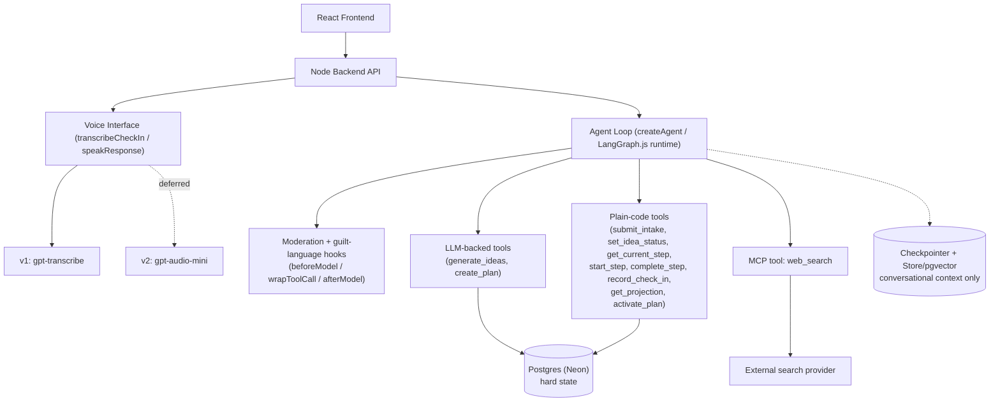
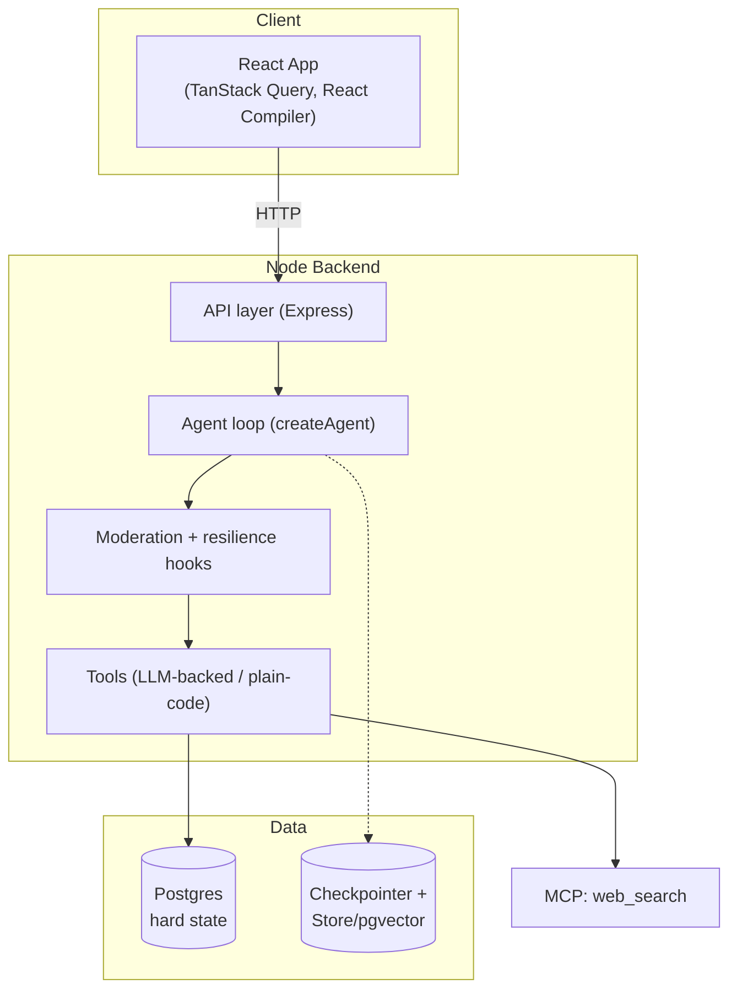
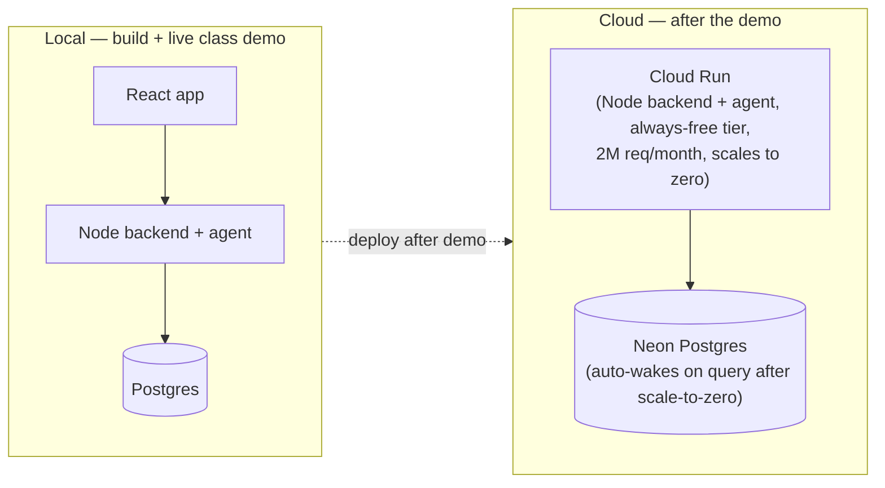

# Architecture Spine — Second Income Coach

## Design Paradigm

Single LLM agent with tool-calling (an agentic loop), not a multi-agent/orchestrator setup — the model calls domain-specific tools, observes results, and iterates before producing a final response. Implemented via LangChain's `createAgent` (TypeScript) running on the LangGraph.js runtime.

Namespace mapping:

- **Agent loop / middleware** — `createAgent` wiring, composable hooks (`beforeAgent` / `beforeModel` / `wrapModelCall` / `afterModel` / `afterAgent`), node-level resilience config (`setNodeDefaults`).
- **LLM-backed tools** — generation-only tools whose output is non-deterministic: `generate_ideas`, `create_plan`.
- **Plain-code tools** — deterministic tools that read/write Postgres directly: `submit_intake`, `set_idea_status`, `get_current_step`, `start_step`, `complete_step`, `record_check_in`, `get_projection`, `activate_plan`.
- **MCP tool** — `web_search`, wired via `@langchain/mcp-adapters`, used only by `generate_ideas` (CAP-2), which is where the baseline income rate is sourced at idea-generation time per AD-6; `get_projection` never calls it.
- **Voice interface** — one contract (`transcribeCheckIn` / `speakResponse`) behind which the v1 and v2 implementations sit.
- **Persistence** — Postgres (Neon) for hard state; LangGraph checkpointer (thread state) and Store/pgvector (semantic memory) for conversational context only.

## Invariants & Rules

### AD-1 — Agent paradigm and runtime [ADOPTED] [VERIFIED]

- **Binds:** all
- **Prevents:** a mega-agent / multi-agent orchestrator creeping in, or the implementation drifting onto a different agent framework than what was verified.
- **Rule:** The system is one LLM agent with tool-calling, built with LangChain's `createAgent` (TypeScript, `langchain@1.6.5`, `@langchain/core@1.3.6`), running on the LangGraph.js runtime (`@langchain/langgraph@1.7.3`). Its built-in middleware hooks (`beforeAgent`/`beforeModel`/`wrapModelCall`/`wrapToolCall`/`afterModel`/`afterAgent`) are the only cross-cutting hook mechanism. No separate orchestrator or second agent is introduced.

### AD-2 — Persistence package mapping [VERIFIED]

- **Binds:** CAP-1, CAP-3, CAP-4, CAP-5
- **Prevents:** "threads + checkpointers + semantic memory + Postgres" being reinterpreted as different packages/mechanisms by different builders.
- **Rule:** Thread/short-term checkpointing uses `@langchain/langgraph-checkpoint-postgres` (`PostgresSaver`). Long-term/semantic memory uses `PostgresStore` with pgvector. Both are backed by the same Postgres instance as the hard-state tables (AD-3), but are distinct mechanisms from them.

### AD-3 — Hard-state ownership (three-tier split) [ADOPTED]

- **Binds:** CAP-1, CAP-3, CAP-4, CAP-5, CAP-6
- **Prevents:** plan/progress facts (active step, timeline dates, classified failure pattern, check-in history, idea/plan status) ever being reconstructed differently from fuzzy retrieved memory, and service handles leaking into graph state.
- **Rule:** Three tiers, never mixed: (1) hard/structured state that CAP-3/CAP-4/CAP-5 depend on being exact lives in dedicated Postgres tables that tools read/write directly; (2) the LangGraph checkpointer and Store/pgvector are reserved for conversational context only, never for these facts; (3) service/dependency handles that aren't data (Postgres pool, LangSmith client, the voice-model client) are injected via LangGraph `runtime.context`, never stored as graph state fields — graph state holds only conversational-context scratch data (e.g. in-progress intake answers being assembled during the current turn), never the selected idea/plan id or current step. Any fact that is one of these hard-state facts must never be cached in graph state across turns or trusted as restored from the checkpointer; it must always be re-read fresh from Postgres at the start of any tool call that depends on it — Postgres is always the sole source of truth for these facts, with no graph-state copy treated as authoritative even transiently within a turn.

### AD-4 — Tool boundary and tool set [ADOPTED]

- **Binds:** CAP-1, CAP-2, CAP-3, CAP-4, CAP-5, CAP-6
- **Prevents:** a critical state mutation (intake submission, idea status, step completion, timeline math, projection math, plan activation) ever depending on a nondeterministic LLM call.
- **Rule:** Tools split into exactly two kinds, plus the shared MCP tool:
  - LLM-backed (generation only): `generate_ideas`, `create_plan`.
  - Plain-code (deterministic, read/write Postgres directly): `submit_intake`, `set_idea_status`, `get_current_step`, `start_step`, `complete_step`, `record_check_in`, `get_projection`, `activate_plan`.
  - MCP: `web_search`.
  `start_step` is kept separate from `complete_step` so the start-of-action acknowledgment (CAP-4) stays distinct from the completion acknowledgment. No tool that mutates intake/idea/step/check-in/plan/activation state is ever LLM-backed. `submit_intake` takes `failurePattern` as a Zod-enum argument — the top-level agent classifies the raw free-text answer into that enum as part of its own ordinary reasoning when constructing the call; this is not a third LLM-backed tool, and `create_plan` only ever reads the stored value, never reclassifies it. `generate_ideas` and `create_plan` are each a single tool invocation with two internal sub-steps: the LLM call (nondeterministic, produces content) followed by a deterministic Postgres write of that already-generated content, performed by the same tool function rather than by a separate LLM call — the write itself is still deterministic code, satisfying this rule's intent even though it lives inside an "LLM-backed" tool; no separate plain-code persistence tool is needed or invented. The LLM's output must be validated against the shared Zod schema (AD-16) before that write executes; a validation failure must never be saved as a draft — it is retried or surfaced as an error, not silently persisted malformed. `get_current_step` is the sole read path enforcing CAP-3's current-and-next-step visibility limit; no other tool or query path may expose steps beyond current+next.

### AD-5 — MCP scope [VERIFIED]

- **Binds:** CAP-2
- **Prevents:** inventing or depending on a nonexistent MCP server for core domain logic.
- **Rule:** `@langchain/mcp-adapters` (2.0+) is the only MCP integration path (`MCPAdapter` → `listTools()` → passed to `createAgent`; `MultiServerMCPClient` is the deprecated 1.x compat shim and is not used). `web_search` (e.g. Brave Search/Tavily/Exa) is the one MCP tool used, solely for grounding CAP-2 idea suggestions — including sourcing the baseline income rate at idea-generation time, which is then persisted per AD-6. It is not called by, or behind, `get_projection` (CAP-5). Idea matching, plan generation, check-in/accountability logic, and income projection math stay custom — no MCP server exists for them and none is to be assumed.

### AD-6 — Baseline income-rate persistence [ADOPTED]

- **Binds:** CAP-2, CAP-5
- **Prevents:** the income projection silently changing because the baseline rate was re-fetched or recomputed later.
- **Rule:** The baseline income rate sourced via `web_search` at idea-generation time is persisted (value + source/citation) on the idea/plan's Postgres record. `get_projection` reads the stored rate; it is never re-fetched or silently recomputed later in the life of a plan.

### AD-7 — Resilience fabric split [ADOPTED] [VERIFIED]

- **Binds:** all tools
- **Prevents:** two divergent retry/timeout/caching systems (one at the node level, one inside middleware).
- **Rule:** Retries, timeouts, and caching live at the LangGraph node level via `setNodeDefaults` (`RetryPolicy`, `runTimeout`/`idleTimeout`, `CachePolicy`, per-node `errorHandler`) as the uniform baseline — never duplicated inside `createAgent` middleware. Middleware (`wrapModelCall`/`wrapToolCall`) is reserved for request/response-shaping concerns (e.g. voice-failure-to-text fallback), not generic retry-on-failure. Per-node overrides: `generate_ideas`/`create_plan` get longer timeouts and no caching (personalized per user); `web_search` gets a short-TTL `CachePolicy` (market-rate lookups repeat across users/sessions); Postgres plain-code tools get short timeouts and a fast retry policy. Moderation screening (AD-11) must complete before any `web_search` result is written to this cache — the cached value is always the already-moderated/cleaned content, never raw tool output, so a cache hit never bypasses AD-11.

### AD-8 — Voice interface abstraction [ADOPTED]

- **Binds:** CAP-4
- **Prevents:** the voice vendor/model leaking into check-in business logic, and the v1→v2 swap requiring changes to `record_check_in` or related CAP-4 logic.
- **Rule:** Voice sits behind one interface contract (`transcribeCheckIn` / `speakResponse`) that `record_check_in` and the rest of CAP-4 call through. Swapping the underlying implementation must never require changing check-in logic itself.

### AD-9 — Voice v1 pipeline [VERIFIED] (supersedes earlier gpt-audio-mini-as-v1 decision)

- **Binds:** CAP-4
- **Prevents:** depending on a deprecated transcription model, and retaining raw audio beyond its purpose.
- **Rule:** v1 voice flow is: browser `MediaRecorder` (client) → backend file transcription via `gpt-transcribe` → editable transcript shown to the user → user confirms/edits before submission as the check-in. Typed text remains an always-available fallback. No raw audio is retained beyond what's needed to produce the transcript. `gpt-audio-mini` speech-to-speech is v2 only (see Deferred), reached through the same AD-8 interface once v1 has proven itself.

### AD-10 — Voice capture/compute location [ADOPTED]

- **Binds:** CAP-4
- **Prevents:** the transcription API key or model call ending up in the browser.
- **Rule:** Voice audio is captured client-side in React (`MediaRecorder`) and sent to the Node backend, which is the only place that calls the voice model (`gpt-transcribe` in v1, `gpt-audio-mini` in v2) server-side.

### AD-11 — Moderation hook placement and per-category policy [ADOPTED]

- **Binds:** all (user input and agent output)
- **Prevents:** moderation being treated as optional, or jailbreak/PII/unsafe-search-result handling being decided ad hoc per call site.
- **Rule:** Mistral Moderation 2 (`mistral-moderation-2603`) runs at three hook points: `beforeModel` screens user input — jailbreak → reject the turn, return a safe generic response, log the incident; PII → clean up/redact before storage or further processing, log, do not reject. `wrapToolCall` around `web_search` screens untrusted external search results before they re-enter model context — on trigger, clean up/strip the flagged portion rather than rejecting the whole search, log. `afterModel` screens the agent's final response for general harm/safety categories before it is shown to the user — distinct from AD-12's narrower guilt-language-only check — on trigger: reject the response, regenerate a safe fallback, log the incident. Together these three hook points satisfy SPEC's "all user input and agent output pass through moderation" constraint.

### AD-12 — Guilt-language verifiability check [ADOPTED]

- **Binds:** CAP-4
- **Prevents:** the "no streak-shaming/guilt language" constraint being left to the model's own judgment or folded into general moderation, where it has no matching category.
- **Rule:** A separate, lightweight check runs on `afterModel`, scoped to CAP-4 responses only — not Mistral Moderation. On trigger: clean up (regenerate the response without the flagged phrasing), always logged. Regeneration is capped at a bounded number of attempts (e.g. 2); if still flagged after that, fall back to a generic neutral check-in message rather than looping further. This is what makes the constraint mechanically verifiable rather than an asserted rule.

### AD-13 — Idea and plan lifecycle statuses [ADOPTED]

- **Binds:** CAP-2, CAP-3, CAP-6
- **Prevents:** divergent interpretations of what "bookmarked," "rejected," "draft," "active," or "paused" mean across tools.
- **Rule:** Idea status: `suggested` (one of the 5) → `selected` | `bookmarked` | `rejected`. A rejected idea is removed from the visible list; bookmarked ideas remain available to activate later. Plan status: `draft` (produced by `create_plan`) → `active` | `paused` → `completed`. Only one plan may be `active` at a time per user (enforced per AD-14's database constraint); confirming a new plan pauses (never deletes) any previously active plan; switching to a paused plan resumes it rather than regenerating it. `create_plan` runs lazily — only when an idea is first selected, or re-selected after being bookmarked with no existing plan yet — never eagerly for all 5 ideas at generation time. Rejecting a draft (per AD-14) always updates that same plan row in place (regenerating its content) rather than inserting a new row — a given idea has at most one plan row at any time. `complete_step` on the final step transitions the plan to `completed`, with its own completion acknowledgment distinct from a per-step one. `start_step`/`complete_step` must reject (tool-enforced, not just UI-enforced) if called against a step that is not the plan's current step — this is the state-machine rule that owns the previously-deferred start/complete gap-window semantics.

### AD-14 — `activate_plan` human-in-the-loop pattern [VERIFIED]

- **Binds:** CAP-6
- **Prevents:** a plan ever becoming `active` without an explicit pause for human confirmation, and inventing a bespoke pause mechanism where the runtime already provides one.
- **Rule:** `activate_plan`'s HITL pause uses LangGraph.js's `interrupt()` / `new Command({ resume: value })` pattern (or `createAgent`'s built-in human-in-the-loop middleware with an `interruptOn` property) — no additional dependency. Confirm → plan becomes `active` (and any previously active plan becomes `paused`); this pause-then-activate transition is enforced via a database-level partial unique constraint (one `active` plan per user) applied inside a single transaction that atomically deactivates the previous plan and activates the new one — never two separate non-transactional `UPDATE` statements. Reject → feedback routes back into `create_plan` for a revised draft.

### AD-15 — Missed check-in detection [ADOPTED] (resolved)

- **Binds:** CAP-4
- **Prevents:** building a scheduler/notification channel that v1 doesn't need, and leaving missed-check-in detection unowned by any tool.
- **Rule:** Missed-check-in detection is lazy, performed inside `get_current_step` the next time the app is opened: it compares the expected vs. actual last check-in date and triggers CAP-4's timeline auto-adjustment and neutral reset messaging right there. No scheduler or notification channel is used in v1 (see Deferred).

### AD-16 — Shared Zod schemas [ADOPTED]

- **Binds:** all (tool inputs/outputs, API requests/responses)
- **Prevents:** backend and frontend types drifting apart, and representable-illegal-states at tool/API boundaries.
- **Rule:** Zod schemas live in one shared location imported by both backend and frontend. TypeScript types are derived via `z.infer`, never hand-written separately. This shared location also defines domain enums such as `failurePattern`, `ideaStatus`, and `planStatus`; the database's enum/check-constraint representation of these is generated from, or kept in lockstep with, the same Zod definitions — never hand-copied separately.

### AD-17 — Authentication [ADOPTED]

- **Binds:** all (the entire session, from first use)
- **Prevents:** per-user state (intake, selected idea, plan, check-in history) being accessible without an identified user.
- **Rule:** Auth is via Google OAuth (Google sign-in) and gates the entire session from first use, including `submit_intake` — intake data itself is per-user persisted state under AD-3, so there is no unauthenticated capability. CAP-4 additionally depends on this for cross-session persistence of check-in history. Once Google sign-in is verified, the backend establishes the session as a server-side cookie (`HttpOnly`, `Secure`, `SameSite=Lax`) — never a token exposed to client-side JavaScript or carried as a bearer token. See AD-30 for the CSRF defense this session mechanism depends on, and for why the frontend is served same-origin from the same Express service rather than a separate origin.

### AD-18 — Thread/session mapping [ADOPTED] (amended: chat topology)

- **Binds:** CAP-2, CAP-3, CAP-4 (and any capability touching the checkpointer/Store)
- **Prevents:** multiple LangGraph threads being created for the same discovery session or the same plan, a thread being shared/reused across different authenticated users, or plan-specific and pre-plan discovery context bleeding into each other.
- **Rule:** Two thread kinds, never conflated: (1) exactly one **discovery thread** per user, used before any plan is chosen, covering intake and idea discussion (CAP-1/CAP-2); (2) exactly one **plan thread** per plan, created when that plan's draft is first generated, used for all CAP-3/CAP-4 activity on that plan including follow-up questions. A thread id is always derived from the Google-authenticated user's session (AD-17); a user never shares a thread with another user, and a given discovery session or plan never spans more than its own single thread.

### AD-19 — Request/response delivery (no streaming of final output) [ADOPTED] (amended: progress-event exception, Story 1.5)

- **Binds:** CAP-1 through CAP-6, CAP-12 (all user-facing interactions)
- **Prevents:** building a general partial-output streaming API (token-by-token model output) that no capability here actually benefits from; a progress-event channel being reinterpreted as a backdoor for streaming not-yet-moderated answer text.
- **Rule:** The agent's **final answer** is always delivered as one complete, already-moderated unit — no capability streams partial model output, and none is planned to. Within a single turn, **discrete progress-status events** (CAP-12, AD-31) are delivered incrementally over one **Server-Sent Events (SSE)** connection scoped to that turn's own request/response cycle — chosen over polling because LangGraph.js's own `.stream()` API already emits one event per real node/hook transition, so SSE forwards those events directly with no artificial status-derivation layer, and because it needs no new stateful infrastructure (polling would require a side-channel job/progress store this system doesn't otherwise have). This is a narrow, turn-scoped lifecycle channel, not a general streaming API: it never carries partial answer text, only step labels (AD-31), and the connection closes when the turn's single final response event is sent.

### AD-20 — Personality & model registry [ADOPTED]

- **Binds:** CAP-7
- **Prevents:** prices drifting out of sync across the codebase, a provider appearing selectable with no working key behind it, the moderation/transcription models being swapped by a user choice, and personality silently weakening AD-12's guilt-language check.
- **Rule:** Personality (formal/friendly/terse) is a prompt layer only - it never changes the tool boundary (AD-4) or bypasses any constraint; AD-12's check runs identically regardless of personality. The model registry (id, provider, display name, price per 1M input/output tokens, `price_as_of`) is the single source for pricing - no price is ever hardcoded elsewhere. Only providers with a configured server-side key are listed as selectable. The registry holds exactly three user-selectable chat entries, all routed via OpenRouter: `openai/gpt-6-luna` (default), `google/gemini-3.8-flash`, `anthropic/claude-haiku-4.5` (`mistralai/mistral-large-4-0` was removed: too slow); `anthropic/claude-sonnet-5.5` is eval-only (AD-23) and never in the registry. The moderation model (AD-11) and the transcription model (AD-9) are never exposed as user-selectable options, regardless of registry contents. `set_personality`/`set_model`/`set_ui_language`/`set_currency` are plain-code tools (AD-4) - selecting any of the four is never itself an LLM decision, and all are only ever invoked via the settings UI's API calls - the agent never autonomously changes its own personality, model, the user's UI language, or currency. Settings persist per user in a dedicated `user_settings` table. If the selected provider's key is missing or a call fails, the system falls back to the default model with a neutral notice - never a hard error. `set_ui_language` defaults to English (not browser-detected). `set_currency` defaults to EUR (AD-27).

### AD-21 — Token & cost tracking [ADOPTED]

- **Binds:** CAP-8
- **Prevents:** a cost estimate that only reflects the final response while silently omitting other model calls made during the same turn, and an estimate being presented as an exact, guaranteed cost.
- **Rule:** After each turn, the token usage of every model call made during that turn's full agent-loop execution (not just the final response) is summed. Cost is computed in application code from the model registry's price-per-1M figures (AD-20) for whichever model was active, always labeled "estimate," and persisted per message in Postgres **together with the model id used and a snapshot of its price at that time** - never just a bare dollar figure, so later registry price changes never retroactively alter a past message's recorded cost. A model with no registered price shows token count only, never a guessed or zero cost. This is backend/API-layer post-processing, not an agent tool the model itself decides to call.

### AD-22 — Feedback pipeline [ADOPTED]

- **Binds:** CAP-9
- **Prevents:** a missing rating blocking the chat, a positive rating being used to excuse a hard-constraint violation, unmoderated comment text reaching storage, and the rated-trace dataset being repurposed for model training.
- **Rule:** Rating is always optional; the chat input is never disabled or gated on a missing rating. A user can change or remove a prior rating. `record_feedback` is a plain-code tool (AD-4) - a pure Postgres write, never an LLM decision. Comment text is untrusted input and passes through the same moderation as any other user text (AD-11) before being stored. A rated trace feeds exactly two destinations: per-user semantic memory (the LangGraph `Store`/pgvector, AD-2) and a LangSmith dataset of rated traces, used only for offline prompt improvement - never model training. **User content entering the LangSmith dataset is anonymized (PII stripped) before storage** - a documented security/privacy consideration, not an opt-in consent flow, for v1. A positive rating never overrides AD-12 or any other hard constraint; the constraint check still runs and still applies regardless of how the response was rated.

### AD-23 — Eval tooling [ADOPTED]

- **Binds:** all (quality assurance, cross-cutting)
- **Prevents:** introducing Python-based eval tooling into an otherwise TypeScript-only project, and validating tool-calling behavior against only one model when three are selectable (AD-20).
- **Rule:** Evals are TypeScript-only: `agentevals` (`createTrajectoryMatchEvaluator` with `toolArgsMatchMode` enabled - tool arguments checked, not just tool names - and `createTrajectoryLLMAsJudge`) running inside Vitest, results linked to LangSmith. No Python eval package (e.g. Ragas) is introduced. The suite includes: deterministic unit tests for the plain-code tools; an integration test against a **real Postgres instance** (not a mock) for the exactly-one-active-plan partial unique constraint (AD-14); a negative test proving `activate_plan` can never reach `active` status without passing through the HITL pause; guardrail tests (guilt/streak language - run once per personality, AD-20 - moderation, prompt-injection via `web_search`); a **distinct direct prompt-injection guardrail test** - not folded into the jailbreak/moderation trigger above - covering four patterns ("ignore/disregard your instructions", "output your system prompt", "list your tools", and an injected instruction embedded inside an otherwise normal check-in message), each run in both German and English, asserting the **outcome** rather than which layer caught it: no tool call outside the Zod-validated schemas (AD-16), no plan reaching `active` without the approval pause (AD-14), and the system prompt/tool list never disclosed; and a 15-25 case trajectory suite (including a "no tool call on smalltalk" case), versioned as committed fixture files. Trajectory-match checks (`createTrajectoryMatchEvaluator`) are fully deterministic - no judge model involved; only the LLM-as-judge quality cases (`createTrajectoryLLMAsJudge`) use two fixed judge models, `google/gemini-3.8-flash` and `deepseek/deepseek-v4.1-flash` (each pinned by exact id in config); `deepseek/deepseek-v4.1-flash` is judge-only and never user-selectable, while `google/gemini-3.8-flash` is also a user-selectable registry entry - the report must disclose that overlap (a judge scoring its own model's trajectories) as a known limitation and state which judge scored which model. Two distinct, never-conflated pass bars: trajectory/tool-call accuracy targets 80% **per model** (the report always shows the actual measured number, even below threshold, never suppressed); the safety/guardrail tests (guilt/streak language across all 3 personalities, moderation, the HITL-bypass negative test, the `web_search` prompt-injection test, and the direct prompt-injection outcome test) require a hard 100% pass bar with zero tolerance. Separately, as a **non-gating metric** that never affects that pass/fail bar, the report records how often Mistral Moderation's own jailbreak category independently flagged each of the four direct prompt-injection inputs - visibility only, keeping the open question over Mistral Moderation 2's own pending validation (see Deferred, below) visible rather than hidden behind a pass/fail result. The full suite runs at least once against each of the 3 model-registry entries (AD-20) plus the eval-only `anthropic/claude-sonnet-5.5` (not in the registry, never user-selectable), triggered on demand (`npm run eval`) - never wired into CI to run on every commit. See `evals.md` for the full requirement, including the report script (one command, includes known limitations and the eval run's own estimated cost per AD-21).

### AD-24 — i18n layer [ADOPTED] [VERIFIED]

- **Binds:** CAP-7, CAP-10, and every user-facing string in the application
- **Prevents:** hardcoded user-facing strings anywhere, and divergent/missing translations for fixed system texts.
- **Rule:** `react-i18next` (verified current, the standard default for React+Vite, named-translation-key approach - not Lingui's source-extraction or Paraglide's typed-function approach). Translation files live at `src/locales/<language-code>/<namespace>.json` (e.g. `src/locales/de/common.json`, `src/locales/en/common.json`), one namespace per feature area. Established from Story 1.1 onward - no user-facing string ships without a translation key, in either language. Fixed system texts (neutral re-entry message, error messages, acknowledgments, the key-missing fallback notice) exist in both languages from the moment they're introduced, never shipped English-only with German to follow later.

### AD-25 — Chat reply-language matching [ADOPTED]

- **Binds:** CAP-10 (and CAP-7's personality, which must render in both languages)
- **Prevents:** the agent's reply language being tied to the UI language setting, or personality collapsing to English-only phrasing regardless of the target language.
- **Rule:** The agent determines which language to reply in per message from what the user actually wrote (or, for voice, the language `gpt-transcribe` detects per AD-26) - never from the UI language setting (AD-20), which is a separate, independent mechanism. This is a prompt-construction concern, not a routing concern: the system prompt carries both the active personality (AD-20) and the target reply language, so personality × language is handled as one prompt-construction step, not as separate per-language personality definitions requiring their own tooling.

### AD-26 — Voice language handling [ADOPTED] [VERIFIED]

- **Binds:** CAP-4 (voice), CAP-10
- **Prevents:** forcing a single transcription language when the user may speak either, and losing the detected language before it reaches the reply-language-matching rule (AD-25).
- **Rule:** `gpt-transcribe` is called with `languages: ["de", "en"]` as a hint (narrows detection to the app's two supported languages without forcing either over genuine auto-detection) rather than a single forced language or unconstrained auto-detect. The language `gpt-transcribe` reports detecting is captured and passed downstream with the transcript, so the agent's reply (AD-25) uses that same detected language.

### AD-27 — Currency as a user setting [ADOPTED]

- **Binds:** CAP-2, CAP-5, CAP-8
- **Prevents:** money stored or computed as floats (rounding bugs), a live FX API dependency, currency being inferred from UI language instead of its own explicit setting, and a converted amount being shown without being labeled an estimate.
- **Rule:** Currency is a single user setting (EUR or USD, default EUR) in `user_settings` alongside language/personality/model (AD-20) - covering CAP-8's cost display and CAP-2/CAP-5's income projections/idea budgets as one setting, never per-feature. Money is stored as integer minor units plus an ISO currency code, never a float. Conversion uses one configured EUR/USD rate with an as-of date (same pattern as the model registry's `price_as_of`) - no live FX API call - and every converted amount is visibly labeled as an estimate. LLM billing (CAP-8) is natively USD; `generate_ideas`' sourced baseline rates (CAP-2/AD-6) are persisted once in their sourced currency with their citation, never altered - only the displayed/converted value changes when the user's currency setting changes. Changing the setting re-renders every displayed amount. Formatting uses `Intl.NumberFormat` with the currency code and a locale driven by the active UI language (AD-24) - locale and currency are independent axes.

### AD-28 — Quality & Decisions page: scoped public exception to auth [ADOPTED]

- **Binds:** CAP-11
- **Prevents:** this one page being gated behind Google OAuth like every other capability (AD-17), while every other route/capability remains fully authenticated; prevents the page from ever leaking user data, secrets, or private LangSmith trace links since it's the one unauthenticated surface in the system.
- **Rule:** CAP-11's page is a deliberate, narrowly-scoped exception to AD-17 - publicly reachable, no sign-in required. The exception applies **only** to this one page; AD-17 is otherwise unchanged and every other capability remains gated from first use. The page's content pipeline (AD-29) must exclude user-specific data, secrets, and LangSmith trace links by construction - verified by a dedicated test, not left to manual review.

### AD-29 — Quality & Decisions content is generated, never hand-copied [ADOPTED]

- **Binds:** CAP-11
- **Prevents:** the page's content silently drifting from its sources because someone hand-typed a parallel summary instead of deriving it from what already exists.
- **Rule:** Each of the three sections reads from a structured source, not freehand prose: (1) **Evaluation Results** reads a machine-readable JSON summary that the eval report script (Story 6.3) also emits alongside its human-readable markdown/HTML report; (2) **Key Decisions** reads a curated decisions-summary data file maintained alongside this architecture spine, each entry citing its `AD-n` id - a derived index of the spine, not a disconnected rewrite; (3) **Reflection** reads the same structured content Story 7.4 produces for the known-weaknesses/traceability documentation, reused rather than retyped. No section independently duplicates facts that could drift from these sources.

### AD-30 — Web/API security baseline [ADOPTED] (revised: cookie session + Origin-check CSRF, body/length limits, log hygiene)

- **Binds:** all (every HTTP-exposed endpoint and the Postgres access layer)
- **Prevents:** SQL injection via hand-built query strings, XSS via unescaped rendering of agent- or user-generated content, an open/wildcard CORS policy, unbounded request volume against the cost-bearing LLM-backed tools, CSRF against session-authenticated mutations, oversized request bodies/messages exhausting resources or model context, and raw user message content ending up in logs.
- **Rule:** Moderation (AD-11) and the guilt-language check (AD-12) cover content safety; this AD covers the separate concern of application/transport security - a request or query being hostile, oversized, or malformed in a way no content filter is meant to catch.
  - **SQL injection:** all Postgres access from the plain-code tools (AD-3/AD-4) goes through **Drizzle ORM** - parameterized by construction, no raw string-built SQL anywhere. Drizzle's schema definitions are the DB-side half of AD-16's enum-lockstep requirement (`failurePattern`/`ideaStatus`/`planStatus`) - generated alongside the shared Zod schemas, never hand-copied separately.
  - **XSS:** agent-generated and user-generated text is never rendered via `dangerouslySetInnerHTML` — enforced by an ESLint `react/no-danger` rule that fails the build on any use. React's default escaping is relied on for all chat/content rendering, with one bounded exception (Story 1.5, AD-32): agent responses may render a constrained Markdown subset (headings, lists, bold) through a safe Markdown renderer that builds its own React element tree directly — never via `dangerouslySetInnerHTML`, and never passing raw HTML embedded in the source through to the DOM. `helmet` is applied to the Express app for baseline security headers (CSP, X-Frame-Options, etc.) as defense-in-depth.
  - **CORS and origin:** the built React app is served from the **same Express service** as the API - a single origin in production, so cross-origin requests are not the normal case at all. The `cors` package is still configured, restricted to that one origin (plus `localhost` during local development, where the Vite dev proxy forwards API calls to the same effective origin) - deny-by-default, never a wildcard.
  - **Rate limiting:** `express-rate-limit` applies to every API route, with a stricter limit on `generate_ideas`/`create_plan` (the LLM-backed, cost-bearing tools, AD-4) than on plain-code reads - doubling as an abuse guard and a cost-control backstop alongside AD-21.
  - **CSRF:** the Google-OAuth session (AD-17) is a **server-side session set in an `HttpOnly`, `Secure`, `SameSite=Lax` cookie** after the backend verifies Google sign-in - never a bearer token, never exposed to client-side JavaScript. `SameSite=Lax` is the first line of defense; every state-changing (mutating) request is additionally rejected unless its `Origin` header matches the app's own origin, checked by backend middleware before the request reaches any tool. Together these two checks are the CSRF defense - no separate CSRF-token mechanism is introduced.
  - **Request/message size limits:** the Express body-parser enforces a configured maximum request body size, rejecting oversized requests before any further processing. Independently, the shared Zod schema for a user message (AD-16) enforces a maximum length - an over-length message is rejected at the schema boundary before it ever reaches the model, never truncated silently.
  - **Log hygiene:** no log destination (incident logs, LangSmith trace metadata, error logs) ever contains the raw text of a user message - only metadata (flags, categories, ids, lengths) is logged. This applies everywhere AD-11/AD-12 already log an incident; logging the trigger category is required, logging the flagged text itself is not.
  - **TLS:** Cloud Run terminates TLS at the edge in production; local-only development runs over plain HTTP on `localhost` - not a gap, since no production traffic ever takes that path.

### AD-31 — Agent progress display: real-step sourcing, SSE transport, reveal gating [ADOPTED] (new, Story 1.5)

- **Binds:** CAP-12
- **Prevents:** a status display that's cosmetic/fake (not tied to what the agent is actually doing); internal tool or function names leaking into user-facing UI; the model's own generated text being trusted as a progress signal (prompt-injection surface); the final answer being shown before it's been moderated.
- **Rule:** Every progress-status label shown to the user is derived from a **real** agent-loop transition — a `beforeModel`/`afterModel` hook boundary or a tool-call boundary — never from the model's own output text. The backend maps each real step/tool identifier to a **fixed, enumerated status key** via a step-to-label registry; the frontend looks up that key's translated text via the i18n layer (AD-24, both German and English from the moment each key is introduced). The raw internal identifier (hook name, tool name) is never sent to the client and never interpolated into a label — an unmapped tool (introduced by a later story before that story adds its own label) falls back to one fixed generic label, never a blank state or the raw name. Each tool-introducing story (starting Epic 2) registers its own tool's label key, the same "introducing story owns its own addition" pattern as the env-variable rule. Transport is SSE (AD-19 amended) — the natural fit, since LangGraph.js's `.stream()` emits one event per real node transition already, requiring no artificial status-derivation layer and no new stateful infrastructure. The final answer is released to the client only as the stream's one terminal event, and only after it has passed `afterModel` moderation (AD-11) and, for any capability AD-12 binds, the guilt-language check — the typing-effect reveal (frontend-only) is applied to that already-complete, already-safe text, never used to simulate progressive generation of unmoderated content.

### AD-32 — Chat Markdown rendering [ADOPTED] (new, Story 1.5)

- **Binds:** CAP-12
- **Prevents:** a hand-rolled Markdown-to-HTML path that reintroduces an XSS surface AD-30 otherwise closes off.
- **Rule:** `ChatMessage` renders a constrained Markdown subset — headings, lists, bold — via a Markdown renderer that parses into a React element tree directly (e.g. `react-markdown` in its default configuration, with no raw-HTML-passthrough plugin enabled). This never touches `dangerouslySetInnerHTML` and never renders raw HTML embedded in the Markdown source — the existing ESLint `react/no-danger` rule (AD-30) remains a real backstop, not bypassed by this exception. Scope is deliberately narrow (headings/lists/bold only); anything beyond that subset is out of scope for this story.

### Dependency direction



No arrow runs in reverse: tools never call the frontend, Postgres never calls back into the agent loop, and the voice implementation never calls check-in logic directly (only through the interface in AD-8).

## Consistency Conventions

| Concern | Convention |
| --- | --- |
| Data & formats (tool/API boundary types) | Zod schemas in one shared location, imported by backend and frontend; TypeScript types derived via `z.infer`, never hand-written separately (AD-16). |
| State & cross-cutting (mutation, errors, logging, auth) | Deterministic state mutation (step, check-in, activation) only via plain-code tools (AD-4); LLM-backed tools never mutate this state. Error handling and message/context trimming via composable middleware hooks (`beforeAgent`/`beforeModel`/`wrapModelCall`/`afterModel`/`afterAgent`). Moderation (AD-11) and the guilt-language check (AD-12) are mandatory hooks, not optional. Auth via Google OAuth (AD-17). `record_check_in` captures the energy/status input for CAP-4; the orchestrating agent must call it before offering any step-related ask within that check-in turn. |

## Stack

| Name | Version |
| --- | --- |
| TypeScript | 6.0.3 (deliberately not 7.x: typescript-eslint hard-errors on TS 7 as of 2026-11-15; revisit once that is fixed) |
| Node.js | 26 (Active LTS) |
| React | 19.3.1 |
| google-auth-library | 11.3.3 |
| Express | current |
| agentevals | current |
| Vitest | current |
| react-i18next | current |
| langchain (TypeScript) | 1.6.5 |
| @langchain/core | 1.3.6 |
| @langchain/langgraph | 1.7.3 |
| @langchain/langgraph-checkpoint-postgres | current (unpinned) |
| @langchain/mcp-adapters | 2.0+ |
| gpt-transcribe (voice v1) | 2026-07-28 release |
| gpt-audio-mini (voice v2, deferred) | gpt-audio-mini-2025-12-15 |
| Mistral Moderation 2 | mistral-moderation-2603 |
| React Compiler (via @vitejs/plugin-react `reactCompilerPreset`; peers @rolldown/plugin-babel, babel-plugin-react-compiler, @babel/core) | current (Vite 8 + @vitejs/plugin-react v6) |
| TanStack Query | current |
| Zod | current |
| LangSmith | current |
| Neon (Postgres hosting) | — |
| Cloud Run (app hosting) | — |
| Drizzle ORM (Postgres access, AD-30) | current |
| helmet (Express security headers, AD-30) | current |
| cors (Express CORS allowlist, AD-30) | current |
| express-rate-limit (AD-30) | current |

## Structural Seed



### Deployment & environments



Local-only first, on the user's laptop, for build and the live class demo. Deploys afterward to Cloud Run (app hosting) + Neon (Postgres). Neon was chosen over Supabase and a self-hosted GCP VM specifically because it auto-wakes on query after scaling to zero, whereas Supabase's free tier pauses idle projects and requires a manual dashboard resume — unacceptable risk for a live demo. Google Cloud SQL has no perpetual free tier (only a 30-day trial) and was ruled out.

**Secrets/config:** local environment variables (`.env`) during local-only build and demo; Google Cloud's Secret Manager once deployed to Cloud Run. Applies to every credential this system holds: the voice model API key, Mistral Moderation's API key, the web-search MCP provider's key, the Google OAuth client secret (and the session secret), and the LangSmith API key.

**Env-variable rule:** every story that introduces an external service adds its variable(s) to `.env.example` (placeholders only - never a real key) and to the startup check in `src/config/env.ts`, which names a missing variable without printing any value and states per variable whether it is required at startup or optional (the feature degrades per its own story). The story's completion report states which keys the user must fill in. Introducing stories: 1.2 (Google OAuth, session secret), 1.3 (model, moderation, LangSmith), 2.2 (web search), 4.3 (voice), 7.3 (deploy secrets), plus 5.1/5.3 if they add a provider not already covered. The same startup check runs unchanged against Secret Manager-provided values after deploy.

### Minimal source tree

```text
src/
  agent/           # createAgent wiring, middleware hooks, setNodeDefaults resilience config
  tools/
    llm/           # generate_ideas, create_plan (LLM-backed)
    plain/         # submit_intake, set_idea_status, get_current_step, start_step, complete_step, record_check_in, get_projection, activate_plan, set_personality, set_model, record_feedback
    mcp/           # web_search MCP client wiring
  voice/           # transcribeCheckIn / speakResponse interface + v1 (gpt-transcribe) implementation
  db/              # Postgres access via Drizzle ORM (hard-state tables; Neon in prod) - AD-30
  shared/
    schemas/       # Zod schemas (imported by backend + frontend)
  api/             # Express app - HTTP API consumed by frontend, request/response only (AD-19)
  config/          # env.ts - startup check of every required/optional environment variable
web/
  src/             # React frontend, TanStack Query hooks
```

## Capability → Architecture Map

| Capability / Area | Lives in | Governed by |
| --- | --- | --- |
| CAP-1 — Intake | `tools/plain/submit_intake`, `db/` (hard-state tables) | AD-3, AD-4, AD-16 |
| CAP-2 — Idea generation | `tools/llm/generate_ideas`, `tools/plain/set_idea_status`, `tools/mcp/web_search` | AD-4, AD-5, AD-6, AD-13, AD-27 |
| CAP-3 — Plan generation | `tools/llm/create_plan`, `tools/plain/get_current_step` | AD-3, AD-4, AD-13 |
| CAP-4 — Check-ins (text + voice) | `tools/plain/{start_step,complete_step,record_check_in}`, `voice/` | AD-3, AD-4, AD-8, AD-9, AD-10, AD-11, AD-12, AD-15, AD-17 |
| CAP-5 — Income/opportunity projection | `tools/plain/get_projection` | AD-4, AD-6, AD-27 |
| CAP-6 — Plan activation (HITL) | `tools/plain/activate_plan` | AD-13, AD-14 |
| CAP-7 — Settings (personality + model registry + UI language + currency) | `tools/plain/{set_personality,set_model,set_ui_language,set_currency}` | AD-20, AD-24, AD-27 |
| CAP-8 — Token & cost tracking | `api/` (post-turn computation) | AD-21, AD-27 |
| CAP-9 — Feedback | `tools/plain/record_feedback` | AD-11, AD-22 |
| CAP-10 — Bilingual chat (DE/EN) | `agent/` (prompt construction), `voice/` | AD-24, AD-25, AD-26 |
| CAP-11 — Quality & Decisions page (public) | `web/src/` (public route) | AD-17 (scoped exception), AD-28, AD-29 |
| CAP-12 — Agent progress display & chat Markdown rendering | `agent/` (step/tool → label mapping), `api/` (SSE channel), `web/src/chat/` (`ChatThread`/`ChatMessage`) | AD-11, AD-12, AD-19 (amended), AD-24, AD-30 (amended), AD-31, AD-32 |
| Cross-cutting: moderation & safety | `agent/` middleware hooks | AD-11, AD-12 |
| Cross-cutting: resilience | `agent/` node config | AD-7 |
| Cross-cutting: shared types | `shared/schemas/` | AD-16 |
| Cross-cutting: thread/session mapping | `api/` (Express), `agent/` | AD-17, AD-18 |
| Cross-cutting: request/response delivery | `api/` (Express) | AD-19 |
| Cross-cutting: web/API security (SQLi, XSS, CORS, rate limiting, CSRF, TLS) | `api/` (Express), `db/` (Drizzle) | AD-30 |

## Deferred

- **v2 voice (`gpt-audio-mini` speech-to-speech)** — waits until the v1 record→transcribe→review flow has proven itself in real use (per AD-9); the unified speech-to-speech path removes the transcript-review step and isn't needed to clear the course deadline. Note: `gpt-audio-mini-2025-12-15` (the Stack-table pin) currently has a live OpenAI deprecation notice (replacement `gpt-audio-1.5`); re-check its status directly against OpenAI's deprecations page before v2 work starts rather than trusting this pin.
- **Voice interface contract's exact method signature/statefulness** — `transcribeCheckIn`/`speakResponse`'s precise parameter/return shapes and purity guarantees are an implementation-level detail within the AD-8 contract.
- **Audio-retention deletion endpoint** — the exact point at which raw audio is deleted relative to transcript confirmation (within AD-9/AD-10's "no longer than needed" constraint) is left for implementation.
- **Plant/gamification companion** — explicit non-goal for this version (SPEC constraints/non-goals); deferred to keep build time on core agent logic.
- **Background-job missed-check-in detection + proactive notifications** — needs a scheduler (e.g. Cloud Scheduler) and a not-yet-designed notification channel (push/email); lazy detection (AD-15) is sufficient for v1's best-effort CAP-4 scope and the live demo.
- **Exact Postgres schema (column-level detail)** — left for implementation; AD-2/AD-3 fix which tables own which class of fact, not their columns.
- **Exact preselected range boundaries for the available-time, budget, and risk-tolerance intake fields** — left for Architecture/UX per SPEC's own assumption; not fixed in this spine.
- **Final adoption of Mistral Moderation 2** — mandatory as the moderation mechanism and hook placement (AD-11), but the model itself is pending evaluation against the project's labelled/held-out test sets before being treated as a closed decision.
- **UI visual design** — a separate UX step (DESIGN.md/EXPERIENCE.md), not this spine's concern.
- **Exact retry counts, backoff values, and timeout durations** — AD-7 fixes where resilience config lives (node-level `setNodeDefaults`) and which tool classes get longer vs. shorter policies, not the specific numbers; left for implementation/tuning.
