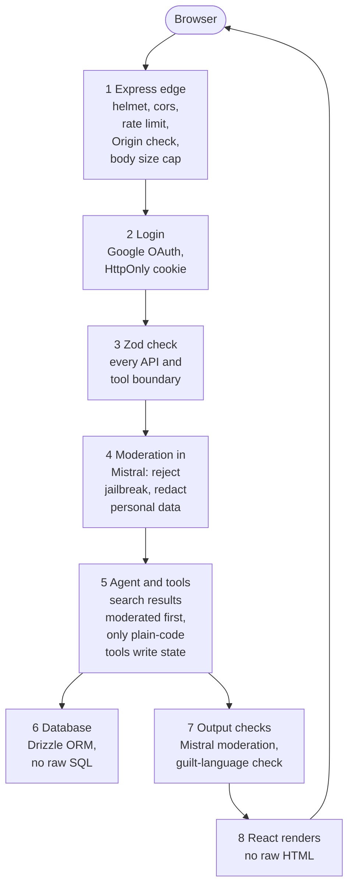
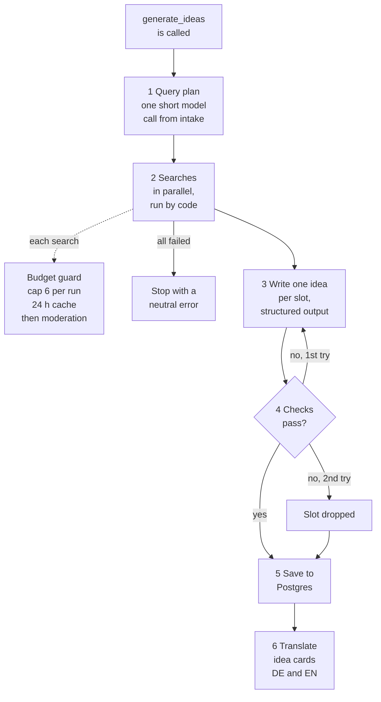

# Technical Rationale

Everything technical about Second Income Coach, once. For capabilities, constraints, and non-goals see the [README](../README.md); for diagrams, the models in use and the dependency direction see [`ARCHITECTURE-SPINE.md`](../_bmad-output/planning-artifacts/architecture/architecture-p_3-2026-11-13/ARCHITECTURE-SPINE.md). `AD-n` ids below are the architecture decision numbers cited in code, tests and the epics; each decision is explained in the section where it appears.

## Agent loop

One LLM agent with tool-calling (an agentic loop): the model calls domain-specific tools, observes results, and iterates before producing a final response (AD-1). Built with LangChain's `createAgent` (TypeScript), running on the LangGraph.js runtime.

**Amendment (speed):** UI button flows (intake save, idea generation, plan creation) call the same tool handlers directly from their API routes — no agent loop around them. The agent loop (moderate → model decides → tool → model narrates → moderate) is reserved for free-form chat turns, where the agent still calls the very same tools, so tool-calling and its evals are unchanged (AD-4 amendment). Intake classification of the free-text "what stopped you before" answer into the `failurePattern` enum (`src/agent/classify-failure-pattern.ts`) is one direct structured-output call to a fast internal model, run in parallel with moderation of that text.

## Single agent, not multi-agent

One LLM with tool-calling; no orchestrator or second agent layered on top. Avoids tool-overload confusion and the coordination/debugging cost a multi-agent setup would add, for a problem (intake → ideas → plan → check-in) that one agent's tool-calling loop already covers end to end (AD-1).

## Tool boundary: LLM-backed vs. plain-code vs. MCP

Tools split into three kinds (AD-4), implemented at `src/tools/{llm,plain,mcp}/`:

- **LLM-backed** (`src/tools/llm/`) — generation only, nondeterministic: `generate_ideas`, `create_plan`. Each is one tool invocation with two internal sub-steps: the LLM call, then a deterministic Postgres write of that already-generated content performed by the same function — the write itself stays deterministic code, so no separate plain-code persistence tool is needed.
- **Plain-code** (`src/tools/plain/`) — deterministic, direct Postgres read/write: `submit_intake`, `set_idea_status`, `get_current_step`, `start_step`, `complete_step`, `record_check_in`, `get_projection`, `activate_plan`, `set_personality`, `set_model`, `set_ui_language`, `set_currency`, `record_feedback`.
- **MCP** (`src/tools/mcp/`) — `web_search`, wired via `@langchain/mcp-adapters`, calling Tavily; used only by `generate_ideas` to ground idea suggestions (including sourcing the baseline income rate, persisted once per AD-6 and never re-fetched by `get_projection`).

### Which tools each agent can call

The model never sees every tool. The server builds separate compiled agents, each with its own tool set (`src/api/index.ts`):

| Where the user is | Agent (thread) | Tools the model can call |
|---|---|---|
| Intake and idea discovery (chat) | discovery agent (`discovery:<user>`) | `submit_intake`, `generate_ideas` (uses `web_search`) |
| "Generate new ideas" button | ideas agent (same tools, longer timeout, no whole-turn retry) | `submit_intake`, `generate_ideas` |
| A plan's chat (draft, active, paused, completed) | plans agent (`plan:<planId>`) | `create_plan`, `get_current_step`, `record_check_in`, `start_step`, `complete_step`; the check-in guilt-language check runs only here |
| Plan review and confirmation | `activate_plan` graph (own `StateGraph`, no model tools) | pauses at `interrupt()`; confirm, modify or reject |

Tools the model **cannot** call, only the UI through API routes (button flows, AD-4 amendment): `set_idea_status` (bookmark, reject, select), `get_projection` (the projection card), `record_feedback` (thumbs), and the settings tools `set_personality`, `set_model`, `set_ui_language`, `set_currency`. They are the same plain-code functions, so the rules and tests stay identical.

No nondeterministic tool is ever allowed to mutate state (AD-4). The LLM's output from `generate_ideas`/`create_plan` is validated against the shared Zod schema before the write executes; a validation failure is retried or surfaced as an error, never silently persisted malformed. `start_step`/`complete_step` reject if called on a step that isn't the plan's current one — state-machine enforcement, not just UI enforcement (AD-13).

## Error and edge-case handling

| Case | What happens | Where |
|---|---|---|
| Slow or failing calls | Retries and timeouts are set per LangGraph node (`setNodeDefaults`), not in middleware (AD-7). `generate_ideas` and `create_plan` get longer timeouts and no caching (personalized output); `web_search` gets a short-TTL cache; plain-code tools get short timeouts and fast retries. A search result is cached only after moderation, so a cache hit never skips AD-11. | `src/agent/resilience.ts` |
| Steps called out of order | `start_step` and `complete_step` reject when the target is not the plan's current step (AD-13). | `src/tools/plain/` |
| Moderation rejections | Jailbreak input ends the turn with a safe generic reply; personal data is redacted, not rejected; unsafe model output is replaced by a safe fallback (AD-11). | `src/agent/moderation.ts` |
| Voice problems | Typed text is always available next to voice check-in (AD-9). | voice route and check-in UI |
| Missing key or failed model call | The system falls back to the default model with a neutral notice, never a hard error (AD-20). | `src/agent/model.ts` |
| Bad configuration | Startup validation names every missing or malformed variable in one error, instead of crashing later on a broken connection. | `src/config/env.ts` |

## Security

Protection sits in layers along the path of a request, not in one place:

- **Auth** — Google OAuth gates the entire session from first use (AD-17); the backend session is a server-side `HttpOnly`/`Secure`/`SameSite=Lax` cookie, never a bearer token exposed to JS.
- **Three moderation hook points** (AD-11, Mistral Moderation 2, `mistral-moderation-2603`): `beforeModel` screens user input (jailbreak → reject + safe generic response + log; PII → redact, log, don't reject); `wrapToolCall` around `web_search` screens untrusted search results before they re-enter model context; `afterModel` screens the agent's final response for general harm/safety categories. A separate, narrower `afterModel` check (AD-12) catches guilt/streak language specifically — not a Mistral category — with bounded regeneration (max 2 attempts) before falling back to a neutral message.
- **Keys/secrets** — every provider is routed through OpenRouter via one `OPENROUTER_API_KEY`; the registry has no per-provider key (`mistral` is the one exception, for the moderation entry, reusing `MISTRAL_API_KEY`). Voice transcription and the API keys it needs are server-side only — nothing sensitive reaches the browser. Secrets live in local `.env` during local-only build/demo, moving to Google Secret Manager on deploy (Story 7.3).
- **Zod validation** at every tool/API boundary (AD-16), shared between backend and frontend via `z.infer`.
- **No raw audio retention** beyond what's needed to produce a check-in transcript (AD-9).
- **Feedback anonymization** — a rated trace entering the LangSmith dataset has user content anonymized (PII stripped) before storage (AD-22); a positive rating never excuses a hard-constraint violation.
- **Web/API baseline** (AD-30): Drizzle ORM parameterizes all Postgres access (no hand-built SQL); agent/user content never renders via `dangerouslySetInnerHTML` (ESLint `react/no-danger` enforced) — chat Markdown goes through a renderer that builds its own React element tree (AD-32); `helmet` security headers; `cors` restricted to the app's own origin; `express-rate-limit` on every route, stricter on `generate_ideas`/`create_plan`; CSRF defense is the `SameSite=Lax` cookie plus an `Origin`-header check on every mutating request, no separate CSRF-token scheme; request body size and message length are capped; no log destination ever contains the raw text of a user message.

## Agent vs. prompt engineering vs. RAG

An agent with tool-calling was chosen over plain prompt engineering because the system needs deterministic state mutation (intake, idea/plan status, step progression, activation) that a prompt alone can't guarantee — those mutations are plain-code tools the agent calls, never free-text the model produces (AD-4). It was chosen over a RAG pipeline because there's no static corpus to retrieve from: idea/plan generation needs live market data, not pre-indexed documents, so the system combines the model's own reasoning with live `web_search` (Tavily) results at generation time, with each sourced rate persisted alongside its citation (AD-6) rather than pulled from a curated knowledge base. No MCP server exists for the actual domain logic (idea matching, plan generation, check-in/accountability, income math) — that stays custom code; `web_search` is the only MCP integration (AD-5).

## How idea generation works

`generate_ideas` is a fixed pipeline run by code, not a free-running agent loop (`src/tools/llm/generate_ideas.ts`). The model writes; code controls the order, the searches and the checks.

1. **Query plan:** one short model call turns the intake into the search queries for this batch. No tools, no loop.
2. **Searches:** the shared demand search runs once for the whole batch, plus one baseline-income-rate search per idea, all in parallel and called directly by code. Each call goes through the budget guard (per-run cap of 6, 24 h cache, shared daily budget) and then Mistral moderation (AD-11), so an untrusted result never reaches the model unchecked and a cache hit never skips moderation. If every search fails, the run stops before any writing call.
3. **Write:** one structured-output model call per idea slot, in parallel, each citing its sources.
4. **Checks (hard failures):** schema, rationale tied to the intake without leaking raw intake values, income rate supported by the quoted source, source trust (no login-wall or blocked pages, no vendor pricing pages). A failed check gives one retry with the failure reason added to the prompt (two attempts in total). Soft issues (idea-type variety, source-domain spread) are only logged.
5. **Save:** passing ideas are written to Postgres with their citations. A slot that fails twice is dropped, so the batch may be shorter than requested. Only if every slot fails does the run end with the neutral error.
6. **Translate:** after saving, the idea cards are translated for the user's language by the fixed translation model.

Batch size is `IDEAS_PER_BATCH` (default 3, matching CAP-2's "3 per batch").

## Models, limits, and cost guard

- **Model registry** (`src/agent/registry.ts`, AD-20): three user-selectable chat entries, all via OpenRouter — `openai/gpt-6-luna` (default), `google/gemini-3.8-flash`, `anthropic/claude-haiku-4.5`. `mistralai/mistral-large-4-0` was removed after it consistently exceeded the model-call timeout in production. `anthropic/claude-sonnet-5.5` is eval-only, never in the registry. The moderation model and the transcription model are never user-selectable regardless of registry contents.
- **Internal-only models** — idea-card translation and intake `failurePattern` classification both use a fixed internal model (`TRANSLATION_MODEL_ID`/`INTAKE_CLASSIFIER_MODEL_ID`, both `openai/gpt-6-luna`), excluded from the selectable list by `category`, never a user choice.
- **Cost tracking** (AD-21) — after each turn, token usage across every model call made during that turn is summed; cost is computed from the registry's price-per-1M figures, always labeled "estimate," persisted per message together with the model id and a price snapshot so later registry price changes never retroactively alter a past message's recorded cost.
- **Rate/search limits** — `express-rate-limit` on every route, tighter on `generate_ideas`/`create_plan`; a shared daily Tavily search budget (`DAILY_SEARCH_BUDGET`) and a per-user daily generation cap (`DAILY_GENERATIONS_PER_USER`), both reset at UTC midnight and enforced in Postgres, with an owner-email exemption list for the generation cap only.

## Memory

Three homes, never mixed (AD-3): (1) hard/structured state — current step, plan status, timeline, idea/plan status, classified failure pattern — lives in dedicated Postgres tables, always re-read fresh, never cached in or trusted from the checkpointer; (2) the LangGraph checkpointer (`@langchain/langgraph-checkpoint-postgres`) and `PostgresStore` with pgvector are reserved for conversational context only — thread state and semantic memory (recalled rated traces, prior conversational context) — never for the hard-state facts above; (3) service handles (DB pool, LangSmith client) are injected via `runtime.context`, never stored as graph state. Each user gets one discovery thread (intake + browsing ideas) plus one thread per activated plan (AD-18).
